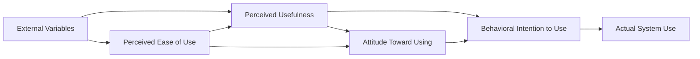
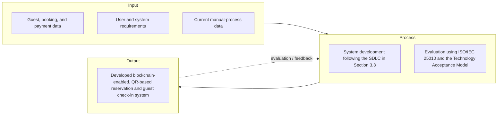
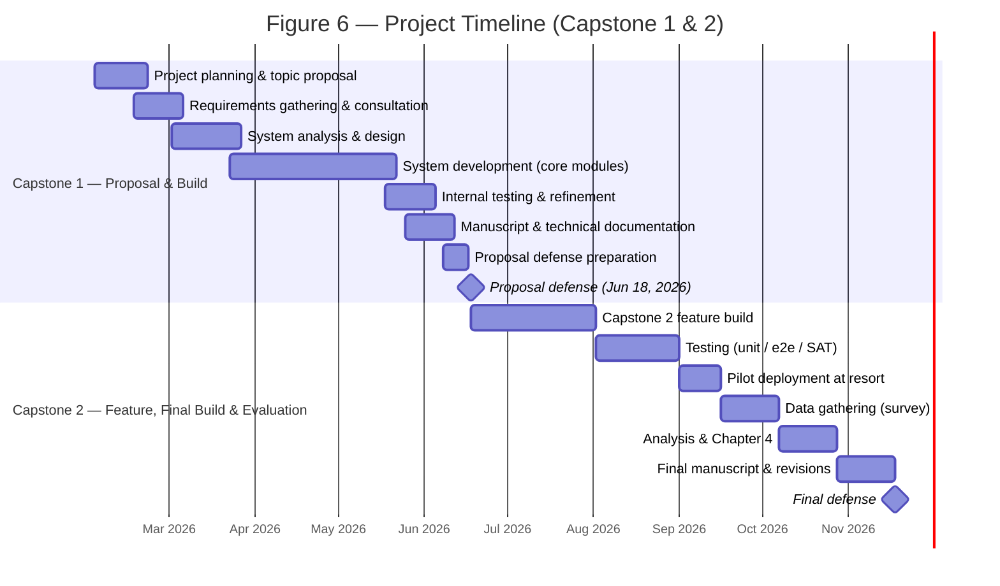

A Blockchain-Enabled Framework for QR-Based Guest Check-In and Reservation Management with AI and PWA for Hillside Hidden Resort

A Research Paper Presented By:

Diwa, Lawrence Andrew A.
Alipao, Rommel Jackson G.

In partial fulfillment of the requirements for the degree of
Bachelor of Science in Information Technology

June 2026

APPROVAL SHEET

This Research Paper entitled A Blockchain-Enabled Framework for QR-Based Guest Check-In and Reservation Management with AI and PWA for Hillside Hidden Resort in partial fulfillment of the requirements for the degree of Bachelor of Science in Information Technology has been examined and is recommended for acceptance for approval for ORAL EXAMINATION.

   Armilyn T. Martinez, MIT
Adviser

PANEL OF EXAMINERS
Approved by the Committee on Oral Examination with a grade of ___________.

 | Ronnie D. Luy, MIT | Ronnie D. Luy, MIT | Ronnie D. Luy, MIT | 
 | College Dean, CCS | College Dean, CCS | College Dean, CCS | 
 |  |  |  | 
Reynaldo G. Bautista Jr., MSCS | Reynaldo G. Bautista Jr., MSCS |  | Paul Vincent P. Corsina, MSCS | Paul Vincent P. Corsina, MSCS
Program Coordinator | Program Coordinator |  | Research Adviser | Research Adviser

 |  | 
Eric Ramos |  | Eden U. Asug
IT Professional |  | Project End-User (Owner, Hillside Hidden Resort)
 |  | 

	Accepted and approved in partial fulfillment of the requirements for the degree of Bachelor of Science in Information Technology.

               ____________
Date of Final Oral Defense

ABSTRACT

**A Blockchain-Enabled Framework for QR-Based Guest Check-In and Reservation Management with AI and
PWA for Hillside Hidden Resort**

By
Lawrence Andrew A. Diwa
Rommel Jackson G. Alipao
Bachelor of Science in Information Technology
June 2026

Armilyn T. Martinez, MIT
Adviser

Hillside Hidden Resort currently handles reservations, payments, and guest check-ins through manual
and semi-digital processes such as social media messaging, phone calls, and logbooks, which lead to
delayed responses, inconsistent records, double bookings, longer transaction times, and the absence
of secure, real-time record-keeping. To address these problems, this study will develop a
blockchain-enabled, QR-based guest check-in and reservation management system integrated with
artificial intelligence and a Progressive Web Application for the resort. The proposed system is
designed as a mobile-first, offline-capable Progressive Web Application that will provide room and
tour booking with real-time availability, online payment through PayMongo GCash hosted checkout
alongside proof-of-payment upload and on-site payment, and check-in and check-out through a signed,
single-use QR pass. Guest personal information will be stored off-chain in a secure database, while
only privacy-safe proofs — reservation escrow state, a guest-pass token, and a batched audit-log
root hash — will be mirrored to the Ethereum Sepolia test network through an optional, non-blocking
audit layer. An optional artificial-intelligence service will provide advisory occupancy
forecasting, pricing recommendations, and guest suggestions, falling back to rule-based logic when
unavailable. The study will follow a descriptive quantitative research design, using a
pre-test/post-test approach. From a population of 105 respondents (100 guests, 3 administrators, and 2 staff), a sample
of 84 will be determined using Slovin's formula. The developed system will be evaluated using all
eight characteristics of the ISO/IEC 25010 software quality model and the Technology Acceptance
Model. The system is expected to improve the resort's operational efficiency, data security, and
guest experience, and to serve as a reference for technology-driven solutions in the hospitality
industry.

**Keywords:** reservation management system, Progressive Web Application, QR code check-in,
blockchain, ISO/IEC 25010, Technology Acceptance Model

ACKNOWLEDGEMENT
We, the researchers, would like to express our deepest gratitude to everyone who contributed to the successful completion of this research study entitled
“A Blockchain-Enabled Framework for QR-Based Guest Check-In and Reservation Management with AI and PWA for Hillside Hidden Resort with Integrated Modern Technologies for Hillside Hidden Resort.”

First and foremost, we sincerely thank our Capstone Instructor, Ms. Armilyn T. Martinez, MIT, for her continuous guidance, patience, encouragement, and invaluable support throughout the development of this study. We also extend our profound appreciation to our Research Adviser Mr. Paul Vincent P. Corsina, MSCS , and our Project/Industry Adviser, Mr. Eric Ramos, for sharing their expertise, constructive feedback, and insights that greatly improved the quality and direction of this research.

We would also like to acknowledge the College of Computer Studies of Gordon College, especially Dean Ronnie D. Luy, MIT, and Program Chair Reynaldo G. Bautista Jr., MSCS, together with the faculty and staff, for providing the necessary academic support, resources, and learning environment that made this capstone project possible.

Our heartfelt gratitude is also extended to the management, staff, and guests of Hillside Hidden Resort for their cooperation and willingness to participate during the system evaluation and data gathering process. Their valuable feedback and real-world insights were essential in the completion and improvement of this study.

We also wish to thank the Panel of Examiners for their time, effort, and constructive recommendations, which significantly helped enhance the quality and presentation of this research.

Lastly, we are deeply grateful to our families and friends for their unconditional love, understanding, encouragement, and moral support throughout the challenges of this journey. Above all, we thank Almighty God for giving us strength, wisdom, and perseverance to successfully complete this endeavor.

DEDICATION
This work is wholeheartedly dedicated first and foremost to Almighty God, the source of strength, wisdom, and courage. In moments when the path was filled with obstacles and giving up felt near, He provided the will to press on and the grace to keep going.

To our beloved families, who never gave up on us and whose unconditional love, patience, and support carried us through every challenge of this journey — this achievement is as much yours as it is ours.

And to our friends, whose constant encouragement and words of motivation reminded us to keep moving forward — thank you for believing in us even when we doubted ourselves.

EXECUTIVE SUMMARY

Hillside Hidden Resort relies on manual and semi-digital methods — Facebook Messenger, phone calls,
walk-in inquiries, and handwritten logbooks — to manage its reservations, payments, and guest
check-ins. Staff verify room availability and record bookings by hand, which results in delayed
responses to inquiries, inconsistent records, and occasional double bookings, especially during peak
periods. Check-in and payment verification are also done manually, lengthening transaction times,
while the lack of a centralized system leaves the resort without real-time monitoring or secure,
tamper-evident records.

To respond to these challenges, this study will develop a blockchain-enabled, QR-based guest
check-in and reservation management system integrated with artificial intelligence and a Progressive
Web Application for Hillside Hidden Resort. The system will cover the full guest lifecycle — from
booking rooms, cottages, and tours with real-time availability, through online payment using
PayMongo GCash (with proof-of-payment upload and on-site payment as alternatives), to contactless
check-in and check-out using a signed, single-use QR pass. It will also provide an in-stay guest
folio, reviews, promotions, notifications, walk-in booking, offline synchronization, and a
role-based back office for four types of users: guests, Front Desk staff, managers, and a system
administrator. To strengthen record integrity, guest personal information will remain off-chain in a
secure database, while only privacy-safe proofs will be mirrored to the Ethereum Sepolia test
network through an optional, non-blocking audit layer. An optional artificial-intelligence service
will offer advisory occupancy forecasting, pricing recommendations, and guest suggestions, with a
rule-based fallback when it is unavailable.

The study will adopt a descriptive quantitative research design, using a pre-test/post-test
approach. The pre-assessment will measure respondents' perceptions of the current manual process, and
the post-assessment will evaluate the developed system. From a population of 105 respondents, a
sample of 84 will be selected using Slovin's formula with stratified allocation, and data will be
analyzed using frequency, percentage, and weighted mean. The developed system will be evaluated
against all eight characteristics of the ISO/IEC 25010 software quality model and the Technology
Acceptance Model.

Upon completion, the system is expected to improve the resort's operational efficiency, reduce the
manual workload of its staff, strengthen data security through tamper-evident records, and provide
guests with a more convenient booking and check-in experience. The study will also serve as a
reference for future researchers exploring technology-driven solutions in the hospitality industry.

TABLE OF CONTENTS
Title Page										i
Approval Sheet									ii
Abstract										iii
Acknowledgement									iv
Dedication										v
Executive Summary								vi
Table of Contents									vii
List of Tables										viii
List of Figures								         ix
Chapter 1
THE PROBLEM AND ITS BACKGROUND
1.1 Background of the Study							1
1.2 Theoretical and Conceptual Framework					3
1.2.1 Theoretical Framework / Review of Related Studies			3
1.2.2 Conceptual Framework							7
1.3 Statement of the Problem							8
1.4 Significance of the Study							10
1.5 Scope and Limitation of the Study					         11
1.6 Definition of Terms							         14
Chapter 2
RESEARCH METHODOLOGY
2.1 Research Design							         16

2.2 Locale of the Study 							         17
2.3 Population and Sampling Techniques					         18
2.4 Research Instrument 							         19
2.5 Data Gathering Procedure						         21
2.6 Statistical Treatment of Data    					         22

Chapter 3
PRESENTATION, ANALYSIS AND INTERPRETATION OF DATA
3.1 Data Analysis and Presentation	<!-- page -->
3.2 Summary on Interpretation of Data (Descriptive Rating)	<!-- page -->
3.3 System Development Life Cycle	<!-- page -->
	3.3.1 Planning
	3.3.2 Analysis
	3.3.3 Design
	3.3.4 Development
	3.3.5 Testing
	3.3.6 Deployment and Implementation
	3.3.7 Maintenance
	3.3.8 Software Quality Metrics
	3.3.9 Technology Acceptance Model

REFERENCES	<!-- page -->
	Books
	Journals/Articles/Issuances/Periodicals
	Electronic Sources

APPENDICES	<!-- page -->
	Appendix B — Evaluation Tool and Test Document	<!-- page -->
	Appendix F — Others	<!-- page -->

CURRICULUM VITAE	<!-- page -->

LIST OF TABLES
Table No. | Table Title | Page
Table 1 | Respondent Sampling | 20
Table 2 | 4-point Likert Scale | 22
Table 3 | Guests — Reservation and Check-In Experience | <!-- page -->
Table 4 | Guests — Inquiry and Reservation Experience | <!-- page -->
Table 5 | Admin/Front Desk — Booking and Reservation Process | <!-- page -->
Table 6 | Admin/Front Desk — Room Availability Management | <!-- page -->
Table 7 | Admin/Front Desk — Inquiry Handling and Workload | <!-- page -->
Table 8 | Operational Staff — Room Status Coordination | <!-- page -->
Table 9 | Operational Staff — Cleaning Operations | <!-- page -->
Table 10 | Summary of Pre-Assessment Section Composites | <!-- page -->
Table 11 | Perceived Need for a Web-Based System (Section 7) | <!-- page -->

LIST OF FIGURES
Figure No. | Figure Title | Page
Figure 1 | Technology Acceptance Model (TAM) for Blockchain-Enabled Framework for QR-Based Guest Check-In and Reservation Management with AI and PWA | 5
Figure 2 | Input–Process–Output (IPO) Model of the Proposed System | 9
Figure 3 | Map of the Study Locale, Hillside Hidden Resort | 19
Figure 4 | Guest Pre-Assessment — Section A Response Distribution | <!-- page -->
Figure 5 | Guest Pre-Assessment — Section B Response Distribution | <!-- page -->
Figure 6 | Project Timeline (Capstone 1 & 2) | <!-- page -->

Chapter 1
THE PROBLEM AND ITS BACKGROUND

1.1 Background of the Study
Hillside Hidden Resort currently handles reservations and guest inquiries through manual and semi-digital methods such as Facebook Messenger, phone calls, and walk-in inquiries. Reservation details are recorded manually by staff using logbooks or basic digital tools, requiring employees to verify room availability and update booking records manually. Many small and medium-sized tourism establishments continue to experience operational challenges due to the use of traditional reservation processes. Manual booking systems often result in inefficient reservation management, delayed responses to customer inquiries, and difficulties in maintaining accurate customer records. These limitations can negatively affect service quality, customer satisfaction, and overall business performance (Rana et al., 2022).
During periods of high booking demand, the resort staff must manually coordinate reservations and confirm room availability, increasing the possibility of delayed responses, inconsistent records, and double bookings. Traditional reservation systems rely heavily on manual data entry and administrative processes, making them susceptible to human error, data inconsistencies, and operational inefficiencies. As the volume of booking requests increases, these limitations become more evident, emphasizing the

 need for digital and automated reservation systems that improve efficiency and customer service (Balasubramanian et al., 2022). As booking inquiries increase, these challenges become more noticeable and may affect the quality of customer service and operational efficiency.
In addition, guest check-in and payment verification processes are performed manually, resulting in longer transaction times and reduced convenience for both guests and staff. The absence of a centralized digital system limits the resort’s ability to monitor reservations in real time and maintain organized transaction records.
Moreover, the resort lacks a secure and automated mechanism for maintaining transaction records and monitoring operational data. Without a tamper-proof audit trail, tracking reservation and payment histories becomes more difficult, which may affect transparency and data integrity. Blockchain technology has emerged as a promising solution for improving the security, transparency, and integrity of digital transactions. It provides an immutable and decentralized ledger that records transactions in a manner that prevents unauthorized modification while ensuring data transparency among authorized participants. These characteristics make blockchain suitable for applications in tourism reservation systems, where secure and reliable transaction records are essential (Rana et al., 2022).The increasing dependence on digital technologies in the tourism and hospitality industry highlights the need for modern reservation management systems. The

Department of Tourism emphasized the importance of digital transformation among tourism-related establishments to improve service quality and operational competitiveness (Department of Tourism, 2022). In response to these challenges, this study proposes a blockchain-enabled, QR-based guest check-in and reservation management system integrated with Artificial Intelligence (AI) and a Progressive Web Application (PWA) for Hillside Hidden Resort. The proposed system aims to improve reservation  efficiency, enhance data security, reduce manual workload, and provide a faster and more convenient experience for both guests and administrators.

1.2 Theoretical and Conceptual Framework
1.2.1 Theoretical Framework / Review of Related Studies
The study’s theoretical framework focuses on theories that explain user acceptance of digital technologies, efficient management of information systems, and secure transaction processing in hospitality operations. The proposed Blockchain-Enabled Framework for QR-Based Guest Check-In and Reservation Management with Artificial Intelligence (AI) and Progressive Web Application (PWA) for Hillside Hidden Resort aims to improve reservation efficiency, enhance operational management, strengthen data security, and provide a faster and more convenient experience for guests and administrators.

The study is anchored on the Technology Acceptance Model (TAM), Information Systems Theory, and Blockchain Theory. These theories support the design, implementation, and evaluation of the proposed system by explaining how users adopt technology, how digital systems improve operational processes, and how blockchain secures transaction records.
Technology Acceptance Model (TAM)
The Technology Acceptance Model (TAM), originally proposed by Fred Davis (1989), is one of the most widely used theories in information systems research. TAM explains that the adoption of a new technology is primarily influenced by two factors: Perceived Usefulness and Perceived Ease of Use. Perceived Usefulness refers to the degree to which a person believes that using a particular system improves task performance, while Perceived Ease of Use refers to the degree to which a person believes that using the system requires minimal effort.
In this study, TAM serves as the primary framework for evaluating the acceptance and usability of the proposed blockchain-enabled reservation and guest check-in system. Perceived Usefulness is reflected through the system’s ability to improve reservation management, automate booking verification, reduce manual errors, provide real-time reports, and streamline QR-based guest check-in and check-out procedures. The integration of Artificial Intelligence (AI) also supports decision-making and operational analytics for resort administrators.

Perceived Ease of Use is represented through the user-friendly Progressive Web Application (PWA) interface that enables guests to reserve rooms, access QR-based booking verification, and monitor reservation details conveniently across multiple devices. For administrators, the system provides a centralized dashboard for managing reservations, payments, and guest records efficiently.
As shown in the theoretical framework, Perceived Usefulness and Perceived Ease of Use influence User Acceptance and Adoption of the proposed system. Increased system adoption is expected to result in improved operational efficiency, faster guest transactions, better data management, and enhanced customer satisfaction within Hillside Hidden Resort.

[Normal (Web)] Figure 1 presents the Technology Acceptance Model (TAM) as proposed by Davis (1989), which will serve as the theoretical basis for evaluating user acceptance of the proposed system. In the model, external variables influence two core beliefs -- Perceived Usefulness and Perceived Ease of Use -- which in turn shape the user's Attitude Toward Using the system. This attitude leads to a Behavioral Intention to Use, which ultimately determines Actual System Use. In this study, Perceived Usefulness and Perceived Ease of Use will be measured through the post-assessment questionnaire to determine how readily the guests and resort personnel will accept and adopt the developed system.

Figure 1. Technology Acceptance Model (TAM) for Blockchain-Enabled Framework for QR-Based Guest Check-In and Reservation Management with AI and PWA

Information Systems Theory
Information Systems Theory explains how organizations use technology to collect, process, manage, and distribute information efficiently. According to Kenneth Laudon and Jane Laudon (2020), information systems improve organizational performance by automating operations, minimizing human errors, and providing accurate and timely information for decision-making.
In hospitality operations, information systems are essential for managing reservations, guest information, payment records, and operational reports. Manual reservation processes are often time-consuming and vulnerable to inconsistencies, especially during peak booking periods. Through the implementation of a centralized digital reservation management system, operational workflows become more organized, accessible, and efficient.
In this study, Information Systems Theory supports the integration of cloud-based databases, real-time reservation monitoring, automated payment verification, and digital reporting features. The proposed system allows administrators to efficiently monitor bookings, manage transaction records, and generate reports in real time, improving overall resort operations and resource management.

Blockchain Theory
Blockchain Theory focuses on the use of decentralized digital ledgers to maintain secure, transparent, and tamper-resistant records of transactions. Furthermore, blockchain technology has the potential to transform tourism operations by supporting secure digital identities, smart contracts, automated payments, and transparent booking processes. Its implementation can reduce fraud, minimize reliance on intermediaries, and improve trust between tourism service providers and customers, making it an effective technology for modern reservation management systems (Balasubramanian et al., 2022).
In this study, Blockchain Theory supports the implementation of secure audit trails for reservations, payment verification, and guest check-in records. The proposed system uses blockchain technology to ensure that transaction records remain accurate, transparent, and tamper-proof. This strengthens trust between the resort management and guests while improving the reliability of operational data. In this study, blockchain will be applied in a hybrid manner: guest information will remain off-chain in a secure database, and only privacy-safe proofs - reservation escrow state, a guest-pass token, and a batched audit-log root hash - will be recorded on the Ethereum Sepolia test network.

Review of Related Studies

**Progressive Web Applications.** Biørn-Hansen et al. (2019) reported that Progressive Web Applications (PWAs) provide cross-platform compatibility, offline capability, and an improved user experience without requiring installation from an application store, making them well suited to systems that must remain accessible across different devices. This study will adopt a PWA so that guests and resort staff at Hillside Hidden Resort can access booking, payment, and check-in functions on any device and retain core functionality during intermittent connectivity.

**Artificial Intelligence in Hospitality.** Ivanov and Webster (2017) examined the adoption of robots, artificial intelligence, and service automation by travel, tourism, and hospitality companies, and argued that these technologies can enhance operational efficiency and service delivery. In this study, artificial intelligence will be applied in an advisory capacity — forecasting occupancy, recommending pricing, and suggesting activities to guests — to support, rather than replace, decisions made by resort personnel.

**Internet of Things and Big Data.** Jiang (2022), in a study of hotel management based on the Internet of Things and big-data analysis, described how hotels can apply the Internet of Things and big-data analysis to support customized services, process automation, and real-time operational monitoring. This study draws on the same principle of real-time, data-driven operation by centralizing reservation, payment, and check-in data so that Hillside Hidden Resort can monitor bookings and operations as they happen.

**Smart Tourism Technologies.** Bingöl and Yang (2025) found that smart tourism technologies enhance the customer experience and contribute to smart tourism environments in which advanced technologies improve the overall travel experience. Within the Philippine context, Ramiscal et al. (2026) reported that digital-technology adoption among Philippine hotels remains uneven — basic digital tools such as electronic payments and mobile check-in are widely used, while the adoption of more advanced technologies is limited. This study responds to that gap by integrating multiple technologies — a PWA, online payment, QR-based check-in, and a blockchain audit layer — in a single system tailored to a small Philippine resort.

**Online Booking Behavior in the Philippines.** Esguerra and Arreza (2021) found that ease of navigation, affordable pricing, rewards, and simple reservation and payment processes strongly motivate tourists in Cebu City to book their accommodations through online platforms and virtual hotel operators. This study takes these motivators into account by providing Hillside Hidden Resort with a straightforward online booking flow, transparent pricing with promotional discounts, and simple payment and check-in steps.

**QR-Based and Contactless Service.** Hao and Chon (2022) found that contactless service in hospitality bridges customer equity, experience, delight, satisfaction, and trust. This study applies contactless principles through a signed, single-use QR code that each confirmed reservation generates for fast check-in and check-out, reducing waiting time and physical contact at the resort's front desk.

**Local Related System.** Ramento et al. (2024) developed a web-based reservation and management system for Nature Spring Resort using an agile methodology, providing real-time room availability and evaluating the system with the ISO/IEC 25010 quality model. Their work demonstrates that a small Philippine resort can be served by a purpose-built web reservation system evaluated against a recognized quality standard. This study extends that approach for Hillside Hidden Resort by adding QR-based check-in, an in-stay guest folio, promotions, notifications, and a blockchain audit layer, and by evaluating the developed system using all eight characteristics of the ISO/IEC 25010 model together with the Technology Acceptance Model.

1.2.2 Conceptual Framework
[Normal (Web)] The conceptual framework of this study is anchored on the integration of the Technology Acceptance Model (TAM) and the Input–Process–Output (IPO) model to explain how the proposed Blockchain-Enabled QR-Based Guest Check-In and Reservation Management System with Artificial Intelligence (AI) and Progressive Web Application (PWA) can improve the operational efficiency and service quality of Hillside Hidden Resort.
[Normal (Web)] The framework illustrates that the adoption and effectiveness of the proposed system are influenced by key user perceptions derived from TAM, specifically Perceived Usefulness and Perceived Ease of Use. These two factors determine the level of User Acceptance, which leads to the actual utilization of the system by both guests and resort personnel.

[Normal (Web)] Figure 2 presents the conceptual framework of the study using the Input-Process-Output (IPO) model. The Input consists of the guest, booking, and payment data; the user and system requirements; and data on the resort's current manual process. The Process covers the development of the system following the software development life cycle described in Section 3.3, together with its evaluation using the ISO/IEC 25010 quality model and the Technology Acceptance Model. The Output is the developed blockchain-enabled, QR-based reservation and guest check-in system for Hillside Hidden Resort. The feedback loop indicates that the results of the evaluation will be used to refine the system so that it meets the intended quality and acceptance criteria.

Figure 2. Input–Process–Output (IPO) Model of the Proposed System

## [Heading 2] 1.3 Statement of the Problem
[Normal (Web)] Hillside Hidden Resort currently relies on manual and semi-digital processes such as logbooks, social media messaging, and phone calls to handle reservations and guest check-ins. Room availability is tracked manually, and guest information is recorded without a centralized system, which often leads to inefficiencies in operations, delays in response time, and inconsistencies in booking records.
[Normal (Web)] The absence of an integrated digital system limits the resort’s ability to efficiently manage reservations, verify payments, and ensure smooth guest

[Normal (Web)] check-in and check-out processes. During peak seasons, these issues become more evident, resulting in double bookings, delayed transactions, and reduced service quality. Additionally, the lack of real-time data monitoring and secure record-keeping affects decision-making and operational transparency.
[Normal (Web)] To address these challenges, this study focuses on developing a blockchain-enabled, QR-based guest check-in and reservation management system integrated with Artificial Intelligence (AI) and a Progressive Web Application (PWA).
[Normal (Web)] Specifically, this study seeks to answer the following questions:
1. How can a blockchain-enabled reservation management system digitize and automate the current manual reservation and guest check-in processes to improve operational efficiency, enhance data security, and reduce human errors?
2. How can a QR-based system be implemented to provide faster, more accurate, and contactless guest check-in and check-out procedures?
3. How can blockchain technology be integrated to ensure secure, transparent, and tamper-proof reservation and transaction records?
4. How can Artificial Intelligence (AI) and Progressive Web Application (PWA) technologies improve system accessibility, decision-making, and user experience for both guests and administrators?

5. How acceptable is the developed blockchain-enabled, QR-based guest check-in and reservation management system when evaluated based on the ISO/IEC 25010 software quality model in terms of:
	5.1 Functional Suitability
	5.2 Performance Efficiency
	5.3 Compatibility
	5.4 Usability
	5.5 Reliability
	5.6 Security
	5.7 Maintainability
	5.8 Portability

# [Heading 1] 1.4 Significance of the Study

[Normal (Web)] The results of this study are expected to provide significant benefits to the following groups:
[Normal (Web)] Hillside Hidden Resort Management. This study is significant to the resort’s management as it introduces a centralized and secure system for handling reservations and guest check-ins. Through automation, real-time tracking, and blockchain-based record-keeping, management can improve operational efficiency, reduce errors, and make data-driven decisions to enhance overall performance.

[Normal (Web)] Staff and Administrators. The system reduces the manual workload of staff by digitizing reservation processes, payment verification, and report generation. It allows administrators to efficiently manage bookings, monitor guest activity, and access organized data, improving productivity and accuracy in daily operations. Within the system, resort personnel are represented by three back-office roles - Front Desk staff, managers, and a system administrator - each granted only the functions appropriate to their responsibilities.
[Normal (Web)] Guests. The study benefits guests by providing a convenient and user-friendly booking experience. Through online reservations, real-time updates, and QR-based check-in, guests can enjoy faster transactions and a smoother check-in process, enhancing their overall experience at the resort.
Future Researchers. This study serves as a valuable reference for future researchers interested in developing technology-driven solutions in the hospitality industry. It provides insights into the integration of blockchain technology, artificial intelligence, QR-based systems, and Progressive Web Applications, which can be further improved or expanded in future studies.
[Normal (Web)] 1.5 Scope and Limitation of the Study

Scope of the Study
The study will develop a mobile-first, offline-capable Progressive Web Application (PWA) for Hillside Hidden Resort covering the complete guest lifecycle from reservation to check-out, together with a role-based back office for resort personnel. The system will provide: room and cottage booking with real-time availability and multi-night, multi-unit reservations; tour reservations (day and night tours) with adult and child rates; online payment through PayMongo GCash hosted checkout, proof-of-payment upload for manual verification, and on-site payment recorded by staff, with a deposit-or-full-payment policy and promotional discount codes; QR-based check-in and check-out using a signed, single-use QR pass; a guest folio for in-stay services (such as room service and spa) settled at check-out; reviews and ratings for completed stays with administrator moderation; in-app notifications for booking, payment, service, and check-in events; walk-in booking taken by Front Desk staff; back-office dashboards for reservations, units, payments, services, promotions, reviews, staff accounts, and revenue reports; an automated booking lifecycle that releases expired unpaid holds and marks no-shows; offline support through a queue that synchronizes when connectivity is restored; and an optional, feature-flagged blockchain audit layer that will mirror privacy-safe proofs (reservation escrow state, a guest-pass token, and a batched audit-log root hash) to the Ethereum Sepolia test network while keeping all guest personal information off-chain. The system will serve four types of users: guests, Front Desk staff, managers, and a system administrator, with access restricted by role.

Limitations of the Study
The study will be conducted for one resort, Hillside Hidden Resort; the dataset and evaluation will be limited to its guests and personnel. The blockchain layer will operate on the Ethereum Sepolia test network (a development chain), not a production main network; on-chain records will have no real monetary value and are used only for proof-of-concept auditing, and the on-chain capabilities are feature-flagged and disabled in the base configuration. Online payments will use the PayMongo test environment, with no real funds transacted during development and evaluation. Online features (live availability, online payment, and blockchain anchoring) will require internet connectivity; only a subset of guest and staff functions will remain available offline. The system will be delivered as a web application (PWA), not a separately installed native mobile application. The artificial-intelligence features (occupancy forecasting, pricing suggestions, and concierge recommendations) will be advisory, will fall back to rule-based logic when the AI service is unavailable, and will leave final decisions with resort personnel. The system interface will be provided in English only.

# [Heading 1] 1.6 Definition of Terms
[Normal (Web)] Artificial Intelligence (AI). In this study, an advisory service that will forecast resort occupancy (using the Prophet time-series model), recommend room pricing (using a scikit-learn regression model), and suggest activities to guests at check-in. The service will be optional, with the system falling back to rule-based logic when it is unavailable; final decisions will remain with resort personnel.

[Normal (Web)] Blockchain Technology. A decentralized, tamper-resistant digital ledger. In this study it will be used in a hybrid manner: guest and payment data will remain off-chain in a secure database, and only privacy-safe proofs - reservation escrow state, a guest-pass token, and a batched audit-log root hash - will be recorded on the Ethereum Sepolia test network to support verifiable, tamper-evident audit records.
[Normal (Web)] Booking Management. The process of handling reservations, guest records, room availability, and payment verification within the system.
[Normal (Web)] Cloud Database. An online database system used to store, manage, and synchronize reservation and guest information in real time.
[Normal (Web)] Dashboard. An interface used by administrators to monitor reservations, verify payments, manage guest records, and generate reports.
[Normal (Web)] Guest Check-In and Check-Out. The process of confirming guest arrival and departure through QR-based verification within the system.
[Normal (Web)] Progressive Web Application (PWA). A web-based application that provides an app-like experience across multiple devices without requiring installation from an app store.

[Normal (Web)] PayMongo. A Philippine online payment gateway used by the system to accept GCash payments through a hosted checkout page; payment confirmation will be received through a provider webhook and confirmed by a server-side reconciliation.
[Normal (Web)] QR Code. A machine-readable digital code generated for each reservation and used for fast and contactless guest verification during check-in and check-out.

[Normal (Web)] QR-Based Reservation System. A digital reservation platform that integrates QR code technology to streamline booking verification and guest transactions.
[Normal (Web)] Real-Time Reporting. The immediate generation and updating of booking records, payment information, and analytics for monitoring and decision-making.
[Normal (Web)] Reservation Management System. A centralized digital platform used for managing reservations, room availability, payments, and guest information.
[Normal (Web)] Role-Based Access Control (RBAC). A security mechanism that restricts system access and permissions according to a user's assigned role. The system will define four roles - guest, Front Desk staff, manager, and system administrator - each with a distinct set of permissions, enforced both at the application-programming-interface layer and within the database functions.
[Normal (Web)] Tamper-Evident Records. Records whose integrity can be verified because a cryptographic hash of each record - and of batches of records - can be anchored to a blockchain; any later alteration is detectable by recomputing the hash.
[Normal (Web)] User Authentication. The process of verifying the identity of users before granting access to the system through secure login credentials.

Chapter 2
RESEARCH METHODOLOGY

2.1 Research Design
[Normal (Web)] 	This study will utilize a descriptive quantitative research design to gather and analyze data regarding the development and evaluation of the proposed resort reservation and management system for Hillside Hidden Resort. The quantitative method will be used to collect responses from selected participants, including resort management, staff, guests, and potential customers who will participate in the pilot testing of the system. Surveys will be conducted to determine the respondents’ assessment of the system’s usability, functionality, efficiency, and overall user experience.
[Normal (Web)] A survey questionnaire will serve as the primary data-gathering instrument, using a 4-point Likert scale to measure the respondents’ perceptions in terms of Perceived Usefulness, Perceived Ease of Use, and user satisfaction based on the Technology Acceptance Model (TAM). The collected data will be statistically analyzed using descriptive statistical tools such as frequency, percentage, and weighted mean to evaluate the effectiveness and acceptability of the proposed system.

2.2 Locale of the Study
[Normal (Web)] 	The study will be conducted at Hillside Hidden Resort, which is managed and operated by its administration. The resort currently relies on manual reservation processes and traditional communication methods such as social media messaging, phone inquiries, and manual logging of reservations and guest records. These operational practices are used to accommodate guests and manage daily resort activities.
[Normal (Web)] Hillside Hidden Resort is selected as the locale of the study because it experiences operational challenges associated with manual processes, including inconsistent record-keeping, risks of double booking, longer processing times, and limited access to real-time reports and monitoring. The absence of a centralized and automated system affects the efficiency of reservation management, payment verification, and guest transactions.
[Normal (Web)] The researchers chose Hillside Hidden Resort to facilitate coordination with the resort administration and staff during the development, implementation, and evaluation of the proposed system. The locale will also provide relevant feedback from resort personnel and guests regarding the functionality, usability, and effectiveness of the system in improving reservation management and operational efficiency.

[Normal (Web)] Figure 3 shows the location of Hillside Hidden Resort, the locale of the study, situated at Purok 7, Jupiter Street, Olongapo City, Zambales. The vicinity view (a) indicates the resort's position relative to the surrounding road network and landmarks, while the site view (b) shows the resort grounds. The resort will serve as the site for the development, implementation, and evaluation of the proposed system.

*(a) Vicinity view*

*(b) Site view*

Figure 3. Map of the Study Locale, Hillside Hidden Resort, Purok 7, Jupiter St., Olongapo City, Zambales (Source: Google Maps, 2026).

2.3 Population and Sampling Techniques
[Normal (Web)] 	The population of this study consists of the guests and personnel of Hillside Hidden Resort who will evaluate the resort’s current reservation and operational processes, including booking inquiries, payment verification, guest record management, and communication services. The respondents will include resort guests, management personnel, and staff members directly involved in the reservation and accommodation process. The study will use stratified random sampling to determine the respondents and ensure proper representation from each group involved in the study.
[Normal (Web)] According to the management of Hillside Hidden Resort, the resort accommodates an estimated average of 100 guests per month. In addition,

[Normal (Web)] the resort has personnel responsible for reservations, guest accommodation, and operational services. These respondents are considered suitable participants because they directly experience and manage the current manual processes implemented by the resort. The total population considered in this study is 105 respondents, composed of 100 guests (the resort's estimated monthly average), 3 resort administrators, and 2 operational staff. From this population, the target sample size will be determined using Slovin's formula, n = N / (1 + N e²), where N is the population size and e is the margin of error. Applying the formula with N = 105 and e = 0.05, the sample size will be n = 105 / (1 + 105 × 0.0025) = 83.17, which will be rounded up to 84 respondents. Proportional (stratified) allocation across the three groups will yield 80 guests, 2 resort administrators, and 2 operational staff. In addition to these respondents, the study's designated information-technology professional will serve as a purposive evaluator of the system's technical characteristics; he is not part of the 105-respondent sampling frame and is therefore not included in the computed sample of 84 respondents.
Group of Respondents | Total of Population | Sample Technique | Sample Size
Guests | 100 | Stratified Random Sampling | 80
Resort Admin | 3 | Stratified Random Sampling | 2
Operational Staff | 2 | Stratified Random Sampling | 2
Total | 105 |  | 84

Table 1. Respondent Sampling
2.4 Research Instrument
[Normal (Web)] 	Researcher-made survey questionnaires will serve as the primary instruments for gathering the necessary data in this study. Consistent with the pre-test/post-test evaluation design, the instrument will be administered in two phases -- a pre-assessment and a post-assessment -- each using a 4-point Likert scale. The pre-assessment questionnaire will measure the respondents' perceptions of the resort's current manual reservation, payment, and check-in process, while the post-assessment questionnaire will measure the respondents' evaluation of the developed system and their acceptance of it based on perceived usefulness and perceived ease of use following the Technology Acceptance Model (TAM).
[Normal (Web)] The research instrument will consist of two phases: a pre-assessment questionnaire and a post-assessment questionnaire. The pre-assessment questionnaire will be used to evaluate the existing manual reservation and operational processes currently practiced by Hillside Hidden Resort, including social media inquiries, phone reservations, manual logging of records, and payment verification. On the other hand, the post-assessment questionnaire will be used to evaluate the developed system after pilot testing and implementation. The post-assessment questionnaire will be a researcher-made questionnaire based on the ISO/IEC 25010 software quality model (ISO, 2011) and will cover all eight quality characteristics: functional suitability, performance efficiency, compatibility, usability, reliability, security, maintainability, and portability, with each characteristic measured through Likert-scale items.
[Normal (Web)] The post-assessment questionnaire will be answered by all respondents for the characteristics they can directly experience — functional suitability, performance efficiency, usability, and reliability — together with the Technology Acceptance Model constructs, while the characteristics that require technical judgment — compatibility, security, maintainability, and portability — will be evaluated by the study's designated information-technology professional.
[Normal (Web)] As administered, the pre-assessment questionnaire was organized into role-specific sections — eight items for guests, twelve items for administrative and front-desk staff, and eight items for operational staff — measuring perceptions of the current manual reservation, payment, and check-in process. A perceived-need section (Section 7), measuring respondents' agreement on the need for a web-based system, was added in the finalized round of administration.
[Normal (Web)] To ensure convenience and accessibility for the respondents, the researchers will prepare two (2) formats of the questionnaire: soft copy and hard copy. This approach will allow the researchers to observe the respondents while answering the questionnaire and provide assistance whenever necessary. The questionnaire will use a 4-point Likert scale, as presented in the table below.

Scale | Range | Interpretation
4 | 3.25-4.00 | Strongly Agree
3 | 2.50-3.24 | Agree
2 | 1.75-2.49 | Disagree
1 | 1.00-1.74 | Strongly Disagree

Table 2. 4-point Likert Scale

2.5 Data Gathering Procedure
[Normal (Web)] 	The researchers will gather data using the two survey questionnaires described in Section 2.4, administered to the guests, resort administrators, and operational staff of Hillside Hidden Resort in two phases that follow a pre-test/post-test evaluation design.
[Normal (Web)] The researchers will first seek permission from the management of Hillside Hidden Resort to conduct the study and deploy the proposed system within the selected locale. Before the system is introduced, the pre-assessment questionnaire will be administered so that the respondents can rate the resort's current manual reservation, payment, and check-in process, including the speed of booking, the accuracy of records, the ease of payment verification, and the waiting time at check-in.
[Normal (Web)] After the pre-assessment, the researchers will introduce the developed system to the respondents and allow them to access and use it during a designated testing period, enabling them to explore its features and functionalities. Following the testing period, the post-assessment questionnaire will be administered to measure the respondents' evaluation of the developed system across the eight ISO/IEC 25010 quality characteristics and their acceptance of it based on the Technology Acceptance Model (TAM).
[Normal (Web)] The pre-assessment was administered in two rounds: an initial administration of the role-specific current-process items, followed by a finalized-instrument administration that added the perceived-need section (Section 7). In the initial round, the questionnaire's introductory text referred to the evaluation of the proposed system while the items measured the current process; this wording inconsistency is acknowledged as an instrument limitation and was corrected in the finalized instrument.
[Normal (Web)] Before answering the questionnaire, the respondents will be informed about the objectives and purpose of the study. They will also be assured that their participation is voluntary and that all information and responses gathered will be treated with strict confidentiality. The researchers will provide assistance to respondents who may encounter difficulties in accessing, understanding, or completing the questionnaire.
[Normal (Web)] After the data gathering period, all accomplished questionnaires will be reviewed to ensure completeness and accuracy of responses. The collected data will then be encoded, organized, tabulated, and analyzed to obtain findings relevant to the objectives of the study.
2.6 Statistical Treatment of Data
[Normal (Web)] The statistical treatment of data in this study will involve quantitative analysis to evaluate the effectiveness, usability, efficiency, and user acceptance of the proposed resort reservation and management system for Hillside Hidden Resort. Descriptive statistical tools such as frequency distribution, percentage, and weighted mean will be used to present, analyze, and interpret the data gathered from the respondents.

[Normal (Web)] Frequency distribution and percentage will be utilized to describe the demographic profile of the respondents, including their classification as guests, resort administrators, or operational staff. These statistical tools will provide an overview of the respondents who participated in the study.
[Normal (Web)] The weighted mean will be applied to determine the respondents’ level of agreement based on the 4-point Likert scale. It will be used to assess the respondents’ evaluation of the proposed system in terms of usability, functionality, efficiency, and overall user experience. In addition, the weighted mean will also be used to evaluate the developed system based on the ISO/IEC 25010 software quality model across all eight quality characteristics: functional suitability, performance efficiency, compatibility, usability, reliability, security, maintainability, and portability, with a weighted mean computed for each characteristic and an overall weighted mean summarizing the system's quality. Furthermore, it will measure the respondents’ level of acceptance of the system based on the Technology Acceptance Model (TAM), particularly perceived usefulness and perceived ease of use.
[Normal (Web)] The results obtained from the statistical analysis will serve as the basis for determining the effectiveness of the proposed system in improving the existing manual reservation processes and enhancing the operational efficiency and guest experience of Hillside Hidden Resort.

Chapter 3
PRESENTATION, ANALYSIS AND INTERPRETATION OF DATA
3.1 Data Analysis and Presentation

This section presents the data gathered from the respondents. The pre-assessment results, which assess the resort's current manual process, are reported below; the post-assessment results, which will evaluate the developed system, will be presented in Sections 3.1.4 and 3.1.5 after the evaluation phase described in Chapter 2.

The pre-assessment survey was administered to eighty-six (86) respondents, consisting of eighty (80) guests, three (3) administrative/front desk staff, and three (3) operational staff of Hillside Hidden Resort, exceeding the computed sample of 84 determined through Slovin's formula. Respondents rated statements about the resort's current manual reservation, payment, and check-in process on a four-point Likert scale (4 — Strongly Agree; 3 — Agree; 2 — Disagree; 1 — Strongly Disagree), interpreted through the weighted mean. One operational staff response contained no item answers and was excluded from item-level computation, yielding an effective n of 85.

Negatively worded (reverse) items are indicated in the tables with (R); for these items, a low weighted mean represents a favorable perception of the current process, and section composites recode them accordingly.

3.1.1 Pre-Assessment Results of Guest Respondents
The guest respondents (n = 80) rated their experience of the current reservation and check-in process. Tables 3 and 4 present their responses.

| Item | 4 | 3 | 2 | 1 | n | WM | Interpretation |
| --- | --- | --- | --- | --- | --- | --- | --- |
| I feel confident making a booking decision based on the information provided. | 69 | 11 | 0 | 0 | 80 | 3.86 | Strongly Agree |
| The room photos accurately represent the actual condition of the room. | 67 | 13 | 0 | 0 | 80 | 3.84 | Strongly Agree |
| I rarely need to ask for additional details before booking. | 57 | 22 | 0 | 0 | 79 | 3.72 | Strongly Agree |
| The reservation process was easy and straightforward to complete. | 73 | 6 | 0 | 0 | 79 | 3.92 | Strongly Agree |

Table 3. Guests — Reservation and Check-In Experience

[Normal (Web)] Figure 4 visualizes the distribution of guest responses for Section A of the pre-assessment.

Figure 4. Guest Pre-Assessment — Section A Response Distribution.

| Item | 4 | 3 | 2 | 1 | n | WM | Interpretation |
| --- | --- | --- | --- | --- | --- | --- | --- |
| My inquiries are responded to in a timely manner. | 53 | 27 | 0 | 0 | 80 | 3.66 | Strongly Agree |
| The booking process is convenient and easy to follow. | 55 | 25 | 0 | 0 | 80 | 3.69 | Strongly Agree |
| The current booking process provides sufficient information for decision-making. | 62 | 18 | 0 | 0 | 80 | 3.77 | Strongly Agree |
| I experience delays when requesting additional room details. (R) | 0 | 0 | 29 | 51 | 80 | 1.36 | Strongly Disagree |

Table 4. Guests — Inquiry and Reservation Experience

[Normal (Web)] Figure 5 visualizes the distribution of guest responses for Section B of the pre-assessment.

Figure 5. Guest Pre-Assessment — Section B Response Distribution.

3.1.2 Pre-Assessment Results of Admin/Front Desk Staff
The administrative and front desk staff (n = 3) rated the current booking and reservation process, room availability management, and inquiry handling. Tables 5 to 7 present their responses.

| Item | 4 | 3 | 2 | 1 | n | WM | Interpretation |
| --- | --- | --- | --- | --- | --- | --- | --- |
| The current booking system efficiently processes and manages reservations. | 3 | 0 | 0 | 0 | 3 | 4.00 | Strongly Agree |
| Booking inquiries are handled promptly and appropriately. | 3 | 0 | 0 | 0 | 3 | 4.00 | Strongly Agree |
| Reservation records are systematically organized and properly maintained. | 3 | 0 | 0 | 0 | 3 | 4.00 | Strongly Agree |
| The current booking process helps minimize missed reservation opportunities. | 3 | 0 | 0 | 0 | 3 | 4.00 | Strongly Agree |

Table 5. Admin/Front Desk — Booking and Reservation Process

| Item | 4 | 3 | 2 | 1 | n | WM | Interpretation |
| --- | --- | --- | --- | --- | --- | --- | --- |
| Room availability is easy to monitor using the current system. | 3 | 0 | 0 | 0 | 3 | 4.00 | Strongly Agree |
| The current system effectively helps prevent double bookings. | 3 | 0 | 0 | 0 | 3 | 4.00 | Strongly Agree |
| Room status updates are accurate and consistently maintained. | 3 | 0 | 0 | 0 | 3 | 4.00 | Strongly Agree |
| Managing room availability becomes difficult during peak seasons. (R) | 0 | 0 | 3 | 0 | 3 | 2.00 | Disagree |

Table 6. Admin/Front Desk — Room Availability Management

| Item | 4 | 3 | 2 | 1 | n | WM | Interpretation |
| --- | --- | --- | --- | --- | --- | --- | --- |
| The system helps manage multiple inquiries efficiently. | 2 | 1 | 0 | 0 | 3 | 3.67 | Strongly Agree |
| Response time to inquiries is consistent and manageable. | 2 | 1 | 0 | 0 | 3 | 3.67 | Strongly Agree |
| Staff workload remains manageable even during peak booking periods. | 2 | 1 | 0 | 0 | 3 | 3.67 | Strongly Agree |
| Manual handling of bookings leads to delays or confusion. (R) | 0 | 0 | 1 | 2 | 3 | 1.33 | Strongly Disagree |

Table 7. Admin/Front Desk — Inquiry Handling and Workload

3.1.3 Pre-Assessment Results of Operational Staff
The operational staff (n = 3; two provided item responses) rated room-status coordination and cleaning operations. Tables 8 and 9 present their responses.

| Item | 4 | 3 | 2 | 1 | n | WM | Interpretation |
| --- | --- | --- | --- | --- | --- | --- | --- |
| Room status updates are effectively communicated to operational staff. | 2 | 0 | 0 | 0 | 2 | 4.00 | Strongly Agree |
| Information regarding room availability for cleaning is clear and properly understood. | 2 | 0 | 0 | 0 | 2 | 4.00 | Strongly Agree |
| Coordination between housekeeping and the front desk is efficient and well organized. | 2 | 0 | 0 | 0 | 2 | 4.00 | Strongly Agree |
| Room status updates are occasionally delayed. (R) | 0 | 0 | 0 | 2 | 2 | 1.00 | Strongly Disagree |

Table 8. Operational Staff — Room Status Coordination

| Item | 4 | 3 | 2 | 1 | n | WM | Interpretation |
| --- | --- | --- | --- | --- | --- | --- | --- |
| Cleaning assignments are well organized and properly coordinated. | 2 | 0 | 0 | 0 | 2 | 4.00 | Strongly Agree |
| Rooms are prepared in a timely manner prior to guest arrival. | 2 | 0 | 0 | 0 | 2 | 4.00 | Strongly Agree |
| Cleaning instructions are received promptly without delays. | 2 | 0 | 0 | 0 | 2 | 4.00 | Strongly Agree |
| Housekeeping workflow is negatively affected by manual coordination processes. (R) | 0 | 0 | 0 | 2 | 2 | 1.00 | Strongly Disagree |

Table 9. Operational Staff — Cleaning Operations

| Respondent group | Section | Composite WM | Interpretation |
| --- | --- | --- | --- |
| Guests | A. Reservation and Check-In Experience | 3.84 | Strongly Agree |
| Guests | B. Inquiry and Reservation Experience | 3.69 | Strongly Agree |
| Admin/Front Desk | A. Booking and Reservation Process | 4.00 | Strongly Agree |
| Admin/Front Desk | B. Room Availability Management | 3.75 | Strongly Agree |
| Admin/Front Desk | C. Inquiry Handling and Workload | 3.67 | Strongly Agree |
| Operational Staff | A. Room Status Coordination | 4.00 | Strongly Agree |
| Operational Staff | B. Cleaning Operations | 4.00 | Strongly Agree |

Table 10. Summary of Pre-Assessment Section Composites (reverse items recoded)

Interpretation of the Pre-Assessment Results
Across all respondent groups, perceptions of the current manual process were favorable. Guests strongly agreed that the reservation process was easy to complete (WM = 3.92) and that booking information supported confident decision-making (WM = 3.86), while strongly disagreeing that they experience delays when requesting additional details (WM = 1.36, reverse-worded — a favorable result). Administrative respondents rated the organization of reservation records and the prevention of double bookings at the maximum weighted mean (4.00), and operational staff likewise rated room-status coordination and cleaning operations at 4.00.
These results indicate that respondents are satisfied with the service delivery of the resort's existing manual process. It should be noted, however, that the instrument measured perceptions of service quality and day-to-day experience; it did not measure the structural capabilities that the proposed system addresses. Regardless of the favorable perception ratings, the current process operates without real-time room availability visible to guests, without an online payment and automated verification channel, without automated booking confirmations and notifications, and without a centralized, tamper-evident record of reservations, payments, and check-ins. These capability gaps are characteristics of the process itself rather than matters of respondent perception, and they constitute the problems identified in Chapter 1 that the proposed system is designed to address. The favorable ratings further suggest that the staff's service quality is a strength to be preserved: the proposed system is intended to augment the existing service delivery with digital capabilities rather than to remedy dissatisfaction with personnel.
The direct assessment of respondents' perceived need for the proposed web-based system is measured separately by Section 7 of the finalized pre-assessment instrument, the results of which are presented below.

| Item | 4 | 3 | 2 | 1 | n | WM | Interpretation |
| --- | --- | --- | --- | --- | --- | --- | --- |
| I would prefer to book and pay for a stay online rather than through Messenger, phone calls, or walk-in. | [pending] | [pending] | [pending] | [pending] | [pending] | [pending] | [pending] |
| I would find it helpful to see real-time room and cottage availability on a website or app. | [pending] | [pending] | [pending] | [pending] | [pending] | [pending] | [pending] |
| An online payment option (such as GCash) would make booking easier and faster. | [pending] | [pending] | [pending] | [pending] | [pending] | [pending] | [pending] |
| A QR code check-in would be faster and more convenient than the current manual check-in. | [pending] | [pending] | [pending] | [pending] | [pending] | [pending] | [pending] |
| Receiving automatic booking confirmations and notifications would improve my experience. | [pending] | [pending] | [pending] | [pending] | [pending] | [pending] | [pending] |
| A system that automatically records bookings, payments, and check-ins would make resort operations easier to manage. (staff/admin) | [pending] | [pending] | [pending] | [pending] | [pending] | [pending] | [pending] |
| Overall, Hillside Hidden Resort needs a web-based reservation and check-in system. | [pending] | [pending] | [pending] | [pending] | [pending] | [pending] | [pending] |

Table 11. Perceived Need for a Web-Based System (Section 7) — pending administration of the finalized instrument

*Narrative interpretation to be written from the actual results upon administration of the finalized instrument.*

3.1.4 Post-Assessment Results for Resort Admin
This subsection will present the post-assessment results for the resort administrators, summarizing their evaluation of the developed system across the experiential quality characteristics (functional suitability, performance efficiency, usability, and reliability) and the Technology Acceptance Model constructs using the weighted mean and its descriptive interpretation. The evaluation of the four technical characteristics — compatibility, security, maintainability, and portability — by the study's designated information-technology professional will also be presented here.

3.1.5 Post-Assessment Results for General Users
This subsection will present the post-assessment results for the general users (guests and operational staff), summarizing their evaluation of the developed system across the experiential quality characteristics and the Technology Acceptance Model constructs using the weighted mean and its descriptive interpretation.

3.2 Summary on Interpretation of Data (Descriptive Rating)

This section will summarize the interpretation of the gathered data using the descriptive rating in Table 2 (the 4-point Likert scale). The overall weighted mean for each of the eight ISO/IEC 25010 quality characteristics and for the Technology Acceptance Model constructs (Perceived Usefulness and Perceived Ease of Use) will be presented and interpreted here once the evaluation is complete.

3.3 System Development Life Cycle

The study will adopt an **iterative and incremental software development life cycle** influenced by Agile practices. Rather than building the entire system in a single pass, the developers will deliver the system in small, working increments — each covering a feature area such as booking, payments, check-in, the guest folio, reviews, promotions, notifications, or the back office — and will revisit earlier increments as requirements are refined. This approach fits a capstone project because it allows the system to be demonstrated and evaluated at each stage and accommodates feedback from resort personnel and the panel.

3.3.1 Planning
The developers will define the project scope, objectives, and constraints, and will identify the modules to be built (guest booking, tour reservations, payments, QR check-in, guest folio, reviews, promotions, notifications, walk-in booking, offline synchronization, the role-based back office, and the blockchain audit layer). A polyglot monorepo will be planned so that the web application, the backend, the optional machine-learning service, the shared data contract, the database, and the smart contracts are organized as separately deployable parts. Tooling, hosting, and third-party services (Supabase, PayMongo, and the Ethereum Sepolia test network) will be selected in this phase.

3.3.2 Analysis
The developers will analyze the resort's current manual and semi-digital processes and translate them into functional and non-functional requirements. The data that the system must store — users, units, tours, reservations, payments, service requests, reviews, promotions, notifications, and audit records — will be modeled, and the four user roles (guest, Front Desk staff, manager, and system administrator) and their permissions will be defined. The trust boundary will be analyzed: the browser will be treated as untrusted, and all privileged operations will be assigned to the backend.

3.3.3 Design
The developers will design the database schema as a set of related tables with row-level security and database functions, the backend as a versioned application-programming interface that centralizes trusted logic, and the frontend as a mobile-first Progressive Web Application. The shared schema package will be designed as the single contract between the frontend and backend. The blockchain audit layer will be designed as an optional, non-blocking add-on that mirrors only privacy-safe proofs. User-interface designs for the guest portal and the back office will be prepared in this phase, and the diagrams in Chapter 3 (or the technical documentation) — entity-relationship diagram, data-flow diagram, use-case diagrams, and the system architecture — will be produced here.

3.3.4 Development
The developers will implement the system incrementally using feature branches, with each increment adding a module and its database migrations, backend endpoints, and frontend screens. The database schema will evolve through sequential, versioned migrations. Business logic that must be transactional or security-critical will be implemented as database functions, while the backend will validate every request and perform privileged work with a service-role credential. The frontend will validate every backend response against the shared schema.

3.3.5 Testing
The developers will test the system at several levels: automated backend tests for the application-programming interface, end-to-end tests of the guest flow together with automated accessibility checks, type-checking and linting as a quality gate, and manual testing of each module. A quality gate combining linting, type-checking, automated tests, and database-migration validation will be run before changes are integrated, and defects found during testing will be corrected in subsequent iterations.

3.3.6 Deployment and Implementation
The system will be deployed as independently hosted services: the web application on a static/web host, the backend and the optional machine-learning service on a cloud application host, and the database on a managed database platform. Deployment will use the same versioned migrations to keep the database schema consistent across environments. The system will then be implemented at Hillside Hidden Resort for pilot testing with real users during the evaluation period.

3.3.7 Maintenance
After deployment, the developers will monitor the system, apply corrective fixes, and refine features based on user feedback. The versioned-migration approach will allow the database to be updated safely, and the modular structure will allow individual modules to be improved without affecting the whole system. Automated jobs (release of expired unpaid holds and no-show marking) will reduce routine maintenance effort.

3.3.8 Software Quality Metrics
The quality of the developed system will be measured using the **ISO/IEC 25010:2011** product-quality model across all eight characteristics — Functional Suitability, Performance Efficiency, Compatibility, Usability, Reliability, Security, Maintainability, and Portability — using the researcher-made questionnaire and the weighted-mean treatment described in Sections 2.4 and 2.6.

3.3.9 Technology Acceptance Model
User acceptance of the developed system will be evaluated using the **Technology Acceptance Model (TAM)**, focusing on Perceived Usefulness and Perceived Ease of Use, to determine how readily guests and resort personnel accept and adopt the system. The TAM results, together with the ISO/IEC 25010 results, will form the basis for the findings, conclusions, and recommendations in Chapter 4.

REFERENCES
Books
Journals/Articles/Issuances /Periodicals
[Normal (Web)] Biørn-Hansen, A., Majchrzak, T. A., & Grønli, T. M. (2019). Progressive web apps: The possible web-native unifier for mobile development. Proceedings of the 14th International Conference on Web Information Systems and Technologies (WEBIST 2019), 344–351. https://doi.org/10.5220/0007728403440351
[Normal (Web)] Bingöl, Z., & Yang, X. (2025). Smart tourism technologies and customer experience. Tourism Management Perspectives, 58, 101380. https://doi.org/10.1016/j.tmp.2025.101380
[Normal (Web)] Davis, F. D. (1989). Perceived usefulness, perceived ease of use, and user acceptance of information technology. MIS Quarterly, 13(3), 319–340. https://doi.org/10.2307/249008
[Normal (Web)] Department of Tourism. (2022). Tourism digital transformation strategy. Republic of the Philippines. https://beta.tourism.gov.ph

[Normal (Web)] Esguerra, J. G., & Arreza, M. K. B. (2021). The motivational factors on using virtual hotel operators' accommodation among tourists in Cebu City, Philippines. Journal of Business on Hospitality and Tourism, 7(3).
[Normal (Web)] Hao, F., & Chon, K. K. S. (2022). Contactless service in hospitality: Bridging customer equity, experience, delight, satisfaction, and trust. International Journal of Contemporary Hospitality Management, 34(1), 113–134.
[Normal (Web)] Ivanov, S., & Webster, C. (2017). Adoption of robots, artificial intelligence, and service automation by travel, tourism and hospitality companies. Tourism Management Perspectives, 24, 74–87. https://doi.org/10.1016/j.tmp.2017.07.004
[Normal (Web)] Jiang, H. (2022). Research on hotel management based on internet of things and big data analysis. International Journal of Reliability, Quality and Safety Engineering, 29(5), 2240004.
[Normal (Web)] Laudon, K. C., & Laudon, J. P. (2020). Management information systems: Managing the digital firm (16th ed.). Pearson.
[Normal (Web)] Ramiscal, R. M. P., Martinez, M. J., Pallaya, J., Villasana, R., Alejandro, A. S., & Malinao, C. W. M. (2026). Smart hospitality: Key drivers of digital technology usage of hotels in Cauayan City, Isabela, Philippines. International Journal of Education Management and Religion, 3(2), 690–705. https://doi.org/10.71305/ijemr.v3i2.1373

[Normal (Web)] Ramento, L. F., Dancel, D. M., Taberlo, E., & Anquillano, K. J. (2024). Web-based reservation and management system for Nature Spring Resort. Journal of Pure and Applied Sciences, 2(2). https://doi.org/10.5281/zenodo.20739138
[Normal (Web)] ISO. (2011). ISO/IEC 25010:2011 Systems and software engineering — Systems and software Quality Requirements and Evaluation (SQuaRE) — System and software quality models. International Organization for Standardization. https://www.iso.org/standard/35733.html
[Normal (Web)] Balasubramanian, S., Sethi, J. S., Ajayan, S., & Paris, C. M. (2022). An enabling framework for blockchain in tourism. Information Technology & Tourism, 24(2), 165–179. https://doi.org/10.1007/s40558-022-00229-6
[Normal (Web)] Rana, R. L., Adamashvili, N., & Tricase, C. (2022). The impact of blockchain technology adoption on tourism industry: A systematic literature review. Sustainability, 14(12), 7383. https://doi.org/10.3390/su14127383

Electronic Sources

APPENDICES

Appendix B — Evaluation Tool and Test Document

> This appendix contains the two survey instruments described in Sections 2.4 and 2.5. Both use a 4-point Likert scale interpreted with the weighted mean (Table 2). **Appendix B.1** is administered before the developed system is introduced (pre-assessment of the current manual process); **Appendix B.2** is administered after the testing period (post-assessment of the developed system).

---

### Appendix B.1 — Pre-Assessment Questionnaire (Current Manual Process)

**Title:** Pre-Assessment of the Current Manual Reservation, Payment, and Check-In Process —
Hillside Hidden Resort

**Directions:** This questionnaire asks about the resort's **current** way of handling reservations,
payments, and check-in (through Facebook Messenger, phone calls, walk-ins, and manual logbooks),
**before** the proposed system is introduced. Please read each statement and mark the response that
best reflects your experience. There are no right or wrong answers; all responses are confidential
and used only for this study.

**Respondent profile:**
- Role: ☐ Guest  ☐ Front Desk staff  ☐ Manager  ☐ System Administrator
- How often you book / handle reservations: ☐ First time  ☐ Occasionally  ☐ Regularly
- Prior experience with online booking systems: ☐ Yes  ☐ No

**Rating scale (4-point Likert):**

| Scale | Range | Interpretation |
|---|---|---|
| 4 | 3.25–4.00 | Strongly Agree |
| 3 | 2.50–3.24 | Agree |
| 2 | 1.75–2.49 | Disagree |
| 1 | 1.00–1.74 | Strongly Disagree |

> **As administered.** The pre-assessment instrument routed items by respondent role: guests answered 8 items, administrative/front desk staff answered 12 items, and operational staff answered 8 items. Reverse-worded items are marked (R); on those a low rating is favorable. Section 7 (Perceived Need for a Web-Based System) was added in the finalized second round.

**Guest respondents (8 items)**

*A. Reservation and Check-In Experience*
1. I feel confident making a booking decision based on the information provided.
2. The room photos accurately represent the actual condition of the room.
3. I rarely need to ask for additional details before booking.
4. The reservation process was easy and straightforward to complete.

*B. Inquiry and Reservation Experience*
5. My inquiries are responded to in a timely manner.
6. The booking process is convenient and easy to follow.
7. The current booking process provides sufficient information for decision-making.
8. I experience delays when requesting additional room details. (R)

**Administrative / Front Desk staff (12 items)**

*A. Booking and Reservation Process*
1. The current booking system efficiently processes and manages reservations.
2. Booking inquiries are handled promptly and appropriately.
3. Reservation records are systematically organized and properly maintained.
4. The current booking process helps minimize missed reservation opportunities.

*B. Room Availability Management*
5. Room availability is easy to monitor using the current system.
6. The current system effectively helps prevent double bookings.
7. Room status updates are accurate and consistently maintained.
8. Managing room availability becomes difficult during peak seasons. (R)

*C. Inquiry Handling and Workload*
9. The system helps manage multiple inquiries efficiently.
10. Response time to inquiries is consistent and manageable.
11. Staff workload remains manageable even during peak booking periods.
12. Manual handling of bookings leads to delays or confusion. (R)

**Operational staff (8 items)**

*A. Room Status Coordination*
1. Room status updates are effectively communicated to operational staff.
2. Information regarding room availability for cleaning is clear and properly understood.
3. Coordination between housekeeping and the front desk is efficient and well organized.
4. Room status updates are occasionally delayed. (R)

*B. Cleaning Operations*
5. Cleaning assignments are well organized and properly coordinated.
6. Rooms are prepared in a timely manner prior to guest arrival.
7. Cleaning instructions are received promptly without delays.
8. Housekeeping workflow is negatively affected by manual coordination processes. (R)

**Section 7 — Perceived Need for a Web-Based System** *(administered in the second round — finalized instrument)*
1. I would prefer to book and pay for a stay online rather than through Messenger, phone calls, or walk-in.
2. I would find it helpful to see real-time room and cottage availability on a website or app.
3. An online payment option (such as GCash) would make booking easier and faster.
4. A QR code check-in would be faster and more convenient than the current manual check-in.
5. Receiving automatic booking confirmations and notifications would improve my experience.
6. A system that automatically records bookings, payments, and check-ins would make resort operations easier to manage. (staff/admin)
7. Overall, Hillside Hidden Resort needs a web-based reservation and check-in system.

---

### Appendix B.2 — Post-Assessment Questionnaire (ISO/IEC 25010 + TAM)

**Title:** Post-Assessment of the Developed System (Blockchain-Enabled QR-Based Guest Check-In and
Reservation Management System) — ISO/IEC 25010 Software Quality Evaluation and Technology Acceptance

**Directions:** This questionnaire asks you to evaluate the **developed system** after using it
during the testing period. Please mark the response that best reflects your experience with the
system. All responses are confidential and used only for this study.

**Respondent profile:**
- Role: ☐ Guest / General User  ☐ Front Desk staff  ☐ Manager  ☐ System Administrator  ☐ IT Professional
- Length of use during testing: ☐ One session  ☐ Several sessions
- Prior experience with online booking systems: ☐ Yes  ☐ No

**Rating scale (4-point Likert):** same legend as B.1 (4 = Strongly Agree … 1 = Strongly Disagree).

> **Respondent routing:** Sections 1, 2, 4, 5, and the TAM section → **all respondents** (guests, staff, and administrators).
> Sections 3, 6, 7, 8 (Compatibility, Security, Maintainability, Portability) → **the study's designated IT Professional** (technical judgment required).

#### Section 1 — Functional Suitability  *(all respondents)*
1. The system provides the booking, payment, check-in, and reporting functions needed to complete resort transactions. *(completeness)*
2. The functions produce correct and accurate results — availability, totals, discounts, and balances. *(correctness)*
3. The functions are appropriate for the tasks of guests and resort staff. *(appropriateness)*
4. The system covers the whole guest flow from reservation to check-out without missing steps. *(completeness)*

#### Section 2 — Performance Efficiency  *(all respondents)*
1. The system responds to actions (searching, booking, loading pages) within an acceptable time. *(time behavior)*
2. The system stays responsive while several users use it at the same time. *(capacity)*
3. The system uses mobile data and battery reasonably. *(resource utilization)*

#### Section 3 — Compatibility  *(IT Professional)*
1. The system works consistently across different devices (phone, tablet, desktop). *(adaptability/co-existence)*
2. The system works across common web browsers. *(co-existence)*
3. The system works together with the payment service (GCash / PayMongo) and other external services without conflict. *(interoperability)*

#### Section 4 — Usability  *(all respondents)*
1. The system is easy to learn for a first-time user. *(learnability)*
2. The interface, labels, and instructions are easy to understand. *(operability / UI aesthetics)*
3. Tasks (booking, paying, checking in) can be completed with little effort. *(operability)*
4. Errors are easy to recognize and recover from. *(user error protection)*
5. The system is usable on a small mobile screen. *(accessibility)*

#### Section 5 — Reliability  *(all respondents)*
1. The system is available when needed. *(availability)*
2. The system behaves consistently and rarely fails. *(maturity)*
3. When a problem occurs (for example a network interruption), the system recovers without data loss — offline queue / payment reconciliation. *(fault tolerance / recoverability)*

#### Section 6 — Security  *(IT Professional)*
1. The system requires proper login and restricts actions according to the user's role. *(authenticity / access control)*
2. Payment and personal information are handled securely. *(confidentiality)*
3. Records (reservations, payments, check-ins) are protected against unauthorized change. *(integrity)*
4. System actions can be traced to the user who performed them (audit trail). *(accountability / non-repudiation)*

#### Section 7 — Maintainability  *(IT Professional)*
1. Problems in the system can be identified and reported clearly. *(analysability)*
2. The system's parts are organized so that changes can be made without affecting unrelated features. *(modularity / modifiability)*
3. The system can be updated with new features or fixes. *(modifiability)*
4. The system's behavior can be checked or tested after a change. *(testability)*

#### Section 8 — Portability  *(IT Professional)*
1. The system can be added to a device easily as a Progressive Web App, without an app store. *(installability)*
2. The system adapts to different screen sizes and environments. *(adaptability)*
3. The system can be accessed from a new device without difficulty. *(replaceability)*

#### Technology Acceptance Model (TAM)  *(all respondents)*
**Perceived Usefulness**
1. Using the system improves the speed of booking, payment, and check-in.
2. The system helps complete resort transactions more accurately than the manual process.
3. The system is useful for the tasks I need to do at the resort.

**Perceived Ease of Use**
1. The system is easy to use without special training.
2. Learning to operate the system is easy for me.
3. Interacting with the system is clear and understandable.

Appendix — Project Timeline (Gantt Scaffold)

> Replace every `<!-- date -->` with real dates. Phases reflect the actual SDLC in §3.3. Mermaid Gantt renders on GitHub/VS Code; for the document, export as an image or draw a table.

**Note:** the Capstone 1 timeline uses the confirmed term dates (February-June 2026); overlapping phases are intentional. The Capstone 2 rows remain to be filled once those dates are set. The same schedule is shown as a table:

| Phase | Activity | Start | End |
| --- | --- | --- | --- |
| Capstone 1 | Project planning & topic proposal | Feb 2, 2026 | Feb 21, 2026 |
| Capstone 1 | Requirements gathering & client consultation | Feb 16, 2026 | Mar 6, 2026 |
| Capstone 1 | System analysis & design | Mar 2, 2026 | Mar 27, 2026 |
| Capstone 1 | System development (core modules) | Mar 23, 2026 | May 22, 2026 |
| Capstone 1 | Internal testing & refinement | May 18, 2026 | Jun 5, 2026 |
| Capstone 1 | Manuscript & technical documentation | May 25, 2026 | Jun 12, 2026 |
| Capstone 1 | Proposal defense preparation | Jun 8, 2026 | Jun 17, 2026 |
| Capstone 1 | Proposal defense | June 18, 2026 (completed) | — |
| Capstone 2 | Assigned feature build | `<!-- date -->` | `<!-- date -->` |
| Capstone 2 | Testing | `<!-- date -->` | `<!-- date -->` |
| Capstone 2 | Pilot deployment | `<!-- date -->` | `<!-- date -->` |
| Capstone 2 | Data gathering | `<!-- date -->` | `<!-- date -->` |
| Capstone 2 | Analysis & Chapter 4 | `<!-- date -->` | `<!-- date -->` |
| Capstone 2 | Final defense | `<!-- date -->` | — |

Appendix F — Others

### Letter of Request to Conduct a Study

Lawrence Andrew A. Diwa
Rommel Jackson G. Alipao
Bachelor of Science in Information Technology
College of Computer Studies, Gordon College
Olongapo City

<!-- date: request letter — confirm actual date -->

**EDEN U. ASUG**
Owner / End-User
Hillside Hidden Resort
Purok 7, Jupiter St., Olongapo City, 2200 Zambales

Dear Mr. Asug:

Greetings of peace and goodwill.

We are fourth-year Bachelor of Science in Information Technology students of Gordon College, Olongapo City, presently undertaking a capstone research study entitled "A Blockchain-Enabled Framework for QR-Based Guest Check-In and Reservation Management with Artificial Intelligence and a Progressive Web Application for Hillside Hidden Resort."

In connection with this undertaking, we would like to respectfully request your permission to conduct our study at Hillside Hidden Resort. The study will involve the development, implementation, and evaluation of the proposed system within the resort. As part of the process, we will gather data from the resort's guests, operational staff, and administrators through survey questionnaires, and we will deploy the proposed system for a designated testing period so that the respondents can use and evaluate it.

We assure you that all information obtained will be treated with strict confidentiality and used solely for academic purposes. The activities will be scheduled at times convenient to your operations to avoid any disruption to the resort's services, and the results of the study will be made available to your management upon completion.

We are hopeful that this request will merit your favorable approval. Thank you for your support and consideration.

Respectfully yours,

_________________________        _________________________
Lawrence Andrew A. Diwa          Rommel Jackson G. Alipao
Proponent                        Proponent

Noted by:

_________________________
Armilyn T. Martinez, MIT
Capstone Instructor / Adviser

Endorsed by:

_________________________        _________________________
Reynaldo G. Bautista Jr., MSCS   Ronnie D. Luy, MIT
Program Coordinator              Dean, College of Computer Studies

Approved by:

_________________________
Eden U. Asug
Owner, Hillside Hidden Resort

---

### Letter to the Respondents

Lawrence Andrew A. Diwa
Rommel Jackson G. Alipao
Bachelor of Science in Information Technology
College of Computer Studies, Gordon College
Olongapo City

<!-- date: administered at pre-assessment, Capstone 2 -->

Dear Respondent,

Greetings.

We are fourth-year Bachelor of Science in Information Technology students of Gordon College, Olongapo City, conducting a capstone research study entitled "A Blockchain-Enabled Framework for QR-Based Guest Check-In and Reservation Management with Artificial Intelligence and a Progressive Web Application for Hillside Hidden Resort."

In line with this study, we would like to request your participation as one of our respondents. You will be asked to answer a pre-assessment questionnaire regarding the resort's current manual reservation and check-in process, and, after using the developed system during a designated testing period, a post-assessment questionnaire evaluating the system's quality and your acceptance of it. Your responses will help us assess and improve the proposed system.

Please be assured that your participation is entirely voluntary, that you may withdraw at any time without any consequence, and that all information you provide will be kept strictly confidential and used solely for academic purposes.

Thank you for your valuable time and cooperation.

Respectfully yours,

_________________________        _________________________
Lawrence Andrew A. Diwa          Rommel Jackson G. Alipao
Proponent                        Proponent

Noted by:

_________________________
Armilyn T. Martinez, MIT
Capstone Instructor / Adviser

CURRICULUM VITAE

Rommel Jackson G. Alipao
Del Pilar, Castillejos, Zambales
0915-560-9384 · jacksonalipao.ja@gmail.com

Educational Background
Bachelor of Science in Information Technology (BSIT)
Gordon College, Olongapo City
Expected Graduation: July 2027

Certifications
- Google Data Analytics Professional Certificate
- IBM Data Analyst Professional Certificate
- Cisco CCNA (Switching, Routing, and Wireless Essentials)

Work Experience
IT Support Specialist, Subic Bay Yacht Club Inc. (2025)
Junior Marketing Developer, Brandcom Computer Store (2024)

Technical Skills
Full-stack web development (React.js, Next.js, TypeScript, Python/FastAPI, PostgreSQL/Supabase); Progressive Web Application (PWA) development; AI integration; UI design (Figma).

Capstone Project
Hillside Hidden Resort System (this study).

CURRICULUM VITAE

Lawrence Andrew A. Diwa
New Cabalan, Olongapo City, Zambales, Philippines
(+63) 9617782377 · lawrencediwa123@gmail.com

Educational Background
Bachelor of Science in Information Technology (BSIT)
Gordon College, Olongapo City
Enrolled 2023 – Present

Work Experience
Intern, K5 News FM 88.7, Olongapo City (June 2025 – August 2025)

Technical Skills
Web development (ReactJS, Next.js, PHP, Laravel, Python, Java, C, MySQL); hardware troubleshooting and information management; embedded systems; Google Workspace, Microsoft Office, and Canva.

Capstone Project
Hillside Hidden Resort System (this study).

