A Blockchain-Enabled Framework for QR-Based Guest Check-In and Reservation Management with AI and PWA for Hillside Hidden Resort

A Capstone Project Documentation Presented By:

Diwa, Lawrence Andrew A.
Alipao, Rommel Jackson G.

In partial fulfillment of the requirements for the degree of
Bachelor of Science in Information Technology

June 2026

APPROVAL SHEET

This Research Paper entitled A Blockchain-Enabled Framework for QR-Based Guest Check-In and Reservation Management with AI and PWA for Hillside Hidden Resort in partial fulfillment of the requirements for the degree of Bachelor of Science in Information Technology has been examined and is recommended for acceptance for approval for ORAL EXAMINATION.

   Armilyn T. Martinez, MIT
Adviser

PANEL OF EXAMINERS
Approved by the Committee on Oral Examination with a grade of ___________.

 | Ronnie D. Luy, MIT | Ronnie D. Luy, MIT | Ronnie D. Luy, MIT | 
 | College Dean, CCS | College Dean, CCS | College Dean, CCS | 
 |  |  |  | 
Reynaldo G. Bautista Jr., MSCS | Reynaldo G. Bautista Jr., MSCS |  | Paul Vincent P. Corsina, MSCS | Paul Vincent P. Corsina, MSCS
Program Coordinator | Program Coordinator |  | Research Adviser | Research Adviser

 |  | 
Eric Ramos |  | Eden U. Asug
IT Professional |  | Project End-User (Owner, Hillside Hidden Resort)
 |  | 

	Accepted and approved in partial fulfillment of the requirements for the degree of Bachelor of Science in Information Technology.

               ____________
Date of Final Oral Defense

TABLE OF CONTENTS
Title Page										i
Approval Sheet									ii
Table of Contents									iii
CHAPTER 1 – INTRODUCTION
1.1 Project Context									1
1.2 Purpose and Description							2
1.3 Objectives of the Project							3
1.3.1 General Objectives								4
1.3.2 Specific Objectives								4
1.4 Scope and Limitation								5
1.5 Significance of the Study							7
1.6 Definition of Terms								8
CHAPTER 2 – REVIEW OF RELATED LITERATURE AND SYSTEMS
2.1 Related Literature								9
2.2 Related Systems								         13
2.3 Synthesis									         16

CHAPTER 3 – TECHNICAL BACKGROUND
3.1 Overview of Technologies						         18
3.2 Development Tools Used					        	         19
3.3 Security Features							         20

CHAPTER 1:
[Normal (Web)] THE PROBLEM AND ITS SETTING
[Normal (Web)] Project Context
[Normal (Web)] Hillside Hidden Resort currently manages reservations and guest check-ins through manual and semi-digital methods, including social media messaging, phone inquiries, and the manual logging of bookings in logbooks or basic digital tools. Staff verify room availability and update records by hand. During peak periods this leads to inconsistent record-keeping, the risk of double bookings, delayed responses, and longer processing times, because there is no centralized system for real-time availability and transaction records.

[Normal (Web)] The resort also lacks an automated mechanism for maintaining and monitoring operational data. Without a secure, tamper-evident record of reservations and payments, tracking transaction histories and supporting management decisions is difficult. This project addresses these problems with an integrated, automated system that centralizes reservations, payments, and check-ins, and adds a privacy-preserving audit capability.
[Normal (Web)] Purpose and Description
[Normal (Web)] The purpose of this project is to design and implement a Blockchain-Enabled QR-Based Guest Check-In and Reservation Management System with Artificial Intelligence (AI) and Progressive Web Application (PWA) for Hillside Hidden Resort.
[Normal (Web)] The system is designed as a web-based centralized platform that allows guests to:
[Normal (Web)] ● View available rooms/cottages and real-time booking status
● Make reservations online through a user-friendly interface
● Receive a unique QR code for fast and contactless check-in
● Track booking status and reservation details

[Normal (Web)] For resort personnel, the system provides role-specific back-office access (Front Desk staff, managers, and a system administrator):
[Normal (Web)] ● A dashboard for managing reservations, payments, and guest records
● QR-based check-in and check-out verification system
● An optional blockchain audit layer that anchors privacy-safe hashes to the Ethereum Sepolia test network for tamper evidence, while records stay off-chain
● Real-time monitoring of bookings and system activity
● Reports (produced by database queries) and advisory AI (occupancy forecasting, pricing recommendations, and concierge suggestions) to support decision-making
[Normal (Web)] This system aims to replace manual and semi-digital processes with an integrated and automated solution, improving operational efficiency, reducing errors, enhancing data security, and providing a faster and more convenient experience for both guests and resort staff.
Objectives of the Project

General Problem
[Normal (Web)] The objective of this project is to develop and implement a blockchain-enabled, QR-based guest check-in and reservation management system integrated with Artificial Intelligence (AI) and a Progressive Web Application (PWA) for Hillside Hidden Resort. The system aims to streamline reservation processes, improve data accuracy, enhance security, and provide real-time access to information to improve overall operational efficiency and customer experience.

## [Heading 2] 1.3.1 General Objective
[Normal (Web)] To design and implement a blockchain-enabled, QR-based reservation and guest check-in system integrated with AI and PWA that enhances booking efficiency, improves guest experience, and ensures secure and reliable resort operations.

## [Heading 2] 1.3.2 Specific Objectives
Develop a web-based reservation platform that digitizes and automates the current manual booking and guest check-in processes.
Design a centralized system where guests can view available rooms/cottages, make reservations, and track booking status in real time.
Implement a QR-based check-in and check-out system to improve speed, accuracy, and convenience during guest arrival and departure.
Integrate blockchain technology to create a secure, transparent, and tamper-proof audit trail for reservations and transactions.
Develop an administrative dashboard that allows staff to manage bookings, verify payments, and monitor system activities efficiently.
Incorporate an advisory AI service (occupancy forecasting, pricing recommendation, and concierge suggestions) that supports staff decision-making, with a rule-based fallback when the service is unavailable.

Implement a Progressive Web Application (PWA) to ensure accessibility across multiple devices and provide a responsive, user-friendly experience.
[Normal (Web)] Scope and Limitations
[Normal (Web)] The system is a mobile-first, offline-capable PWA that covers the guest lifecycle from reservation to check-out and a role-based back office. It provides room and cottage booking, tour reservations, online and manual payments, QR-based check-in and check-out, a guest folio for in-stay services, reviews and ratings, promotions, in-app notifications, walk-in booking, back-office dashboards (reservations, units, payments, services, promotions, reviews, staff accounts, and revenue reports), an automated booking lifecycle (auto-release of unpaid holds and no-show marking), offline support with a synchronizing queue, and an optional blockchain audit layer that can mirror privacy-safe proofs (escrow state, a guest-pass token, and a batched audit-log root hash) to the Ethereum Sepolia test network while keeping guest personal information off-chain. Access is restricted across four roles: guest, Front Desk staff, manager, and system administrator.

[Normal (Web)] The system is implemented for a single resort. The blockchain layer runs on the Ethereum Sepolia test network (no production main network, no real monetary value) and its on-chain capabilities are feature-flagged and disabled by default. Online payments use the PayMongo test environment. Online features require internet connectivity; only a subset of functions is available offline. The product is a web application (PWA), not a separately installed native app. The AI features are advisory and fall back to rule-based logic when the AI service is unavailable. The interface is English only.

# [Heading 1] Significance of the Study

# [Heading 1] The results of this study are expected to provide significant benefits to the following groups:
[Normal (Web)] Hillside Hidden Resort Management. This study is significant to the resort’s management as it introduces a centralized and secure system for handling reservations and guest check-ins. Through automation, real-time tracking, and blockchain-based record-keeping, management can improve operational efficiency, reduce errors, and make data-driven decisions to enhance overall performance.
[Normal (Web)] Staff and Administrators. The system reduces the manual workload of staff by digitizing reservation processes, payment verification, and report generation. It allows administrators to efficiently manage bookings, monitor

[Normal (Web)] guest activity, and access organized data, improving productivity and accuracy in daily operations.
[Normal (Web)] Guests. The study benefits guests by providing a convenient and user-friendly booking experience. Through online reservations, real-time updates, and QR-based check-in, guests can enjoy faster transactions and a smoother check-in process, enhancing their overall experience at the resort.
[Normal (Web)] Future Researchers. This study serves as a valuable reference for future researchers interested in developing technology-driven solutions in the hospitality industry. It provides insights into the integration of blockchain technology, artificial intelligence, QR-based systems, and Progressive Web Applications, which can be further improved or expanded in future studies.

CHAPTER 2
REVIEW OF RELATED LITERATURE AND SYSTEMS

2.1 Related Literature
Foreign Literature
[Normal (Web)] The integration of digital technologies in the hospitality industry has significantly transformed how reservations, guest services, and operational processes are managed. Modern systems aim to provide centralized platforms that automate tasks such as booking management, real-time availability tracking, and customer interaction. According to Buhalis and Law (2008), the adoption of information technology has revolutionized tourism by enabling automation, improving communication, and enhancing service delivery. These advancements allow hospitality businesses to operate more efficiently while meeting the growing expectations of customers for convenience and speed.
[Normal (Web)] Artificial Intelligence (AI) has become an important component in modern hospitality systems, particularly in enhancing customer experience and decision-making processes. AI technologies enable systems to analyze large volumes of data, identify patterns, and provide personalized recommendations based on user preferences. Ivanov and Webster (2017) emphasized that AI can improve operational efficiency and customer satisfaction by optimizing resource allocation and predicting customer behavior. Similarly, recent studies highlight that AI-driven systems can

[Normal (Web)] personalize services, such as recommending accommodations based on budget, number of guests, and preferences, thereby improving customer engagement and loyalty (Ivanov & Webster, 2017). The integration of AI also supports the development of smart tourism environments, where advanced technologies enhance the overall travel experience (Bingöl & Yang, 2025).
[Normal (Web)] In addition, the use of big data and connected technologies such as the Internet of Things (IoT) has further improved hotel management systems. According to Jiang (2022), IoT and big data allow hotels to provide customized services, automate processes such as check-in and booking, and improve guest satisfaction by delivering personalized experiences. These technologies enable real-time data processing, which enhances operational efficiency and supports better decision-making within the hospitality industry.
[Normal (Web)] Blockchain technology has also emerged as a reliable solution for ensuring data security and transparency in digital systems. Nakamoto (2008) introduced blockchain as a decentralized and immutable ledger system that records transactions securely. This technology has since been applied across various industries, including hospitality, to ensure data integrity and prevent unauthorized modifications (Casino et al., 2019). By providing a tamper-proof record of transactions, blockchain enhances trust and accountability in reservation and payment systems.

[Normal (Web)] Furthermore, Progressive Web Applications (PWAs) have gained popularity as an alternative to traditional mobile applications. According to Biørn-Hansen et al. (2019), PWAs provide cross-platform compatibility, offline capabilities, and improved user experience without requiring installation. This makes them suitable for reservation systems that need to be accessible across different devices. Additionally, QR code technology has been widely adopted for contactless services in hospitality. Hao and Chon (2022) explained that QR codes enable fast and efficient check-in processes, reducing waiting time and minimizing physical contact, which improves both operational efficiency and customer experience.

Local Literature
[Normal (Web)] In the Philippines, the adoption of digital technologies in the hospitality industry continues to grow, although many small and medium-sized resorts still rely on manual or semi-digital systems. These include the use of social media platforms, phone calls, and logbooks for managing reservations. Digital-technology adoption among Philippine hotels remains uneven: while basic digital tools such as electronic payments and mobile check-in are widely used, the adoption of more advanced technologies is limited, leaving many smaller establishments reliant on manual or semi-digital processes (Ramiscal et al., 2026).

[Normal (Web)] The rapid growth of the tourism industry in the Philippines has increased the demand for more efficient and technology-driven solutions. Studies show that the internet has significantly influenced how tourists search for accommodations, compare services, and make booking decisions. Factors such as ease of navigation, affordable pricing, rewards, and simple reservation and payment processes strongly motivate tourists to book their accommodations through online platforms and virtual hotel operators (Esguerra & Arreza, 2021). As a result, resorts and hotels are encouraged to adopt digital systems to remain competitive in an increasingly technology-driven market.
[Normal (Web)] The Department of Tourism has also emphasized the importance of digital transformation in improving service quality and maintaining competitiveness within the tourism sector (Department of Tourism, 2022). However, adoption remains limited among smaller establishments due to constraints such as cost, lack of technical expertise, and limited access to advanced technologies.
[Normal (Web)] Recent studies also highlight the growing importance of smart technologies, including AI and IoT, in improving hospitality operations. According to Ramiscal et al. (2026), the integration of these technologies enhances service quality, enables personalized customer experiences, and improves operational efficiency. Hotels that adopt multiple smart technologies benefit from better process optimization and increased customer satisfaction.

[Normal (Web)] Moreover, online travel platforms and digital booking systems have significantly influenced consumer behavior in the tourism industry. Online travel platforms allow users to easily search for accommodations, compare prices, read reviews, and access promotions, making travel planning more convenient and accessible. These technologies have reshaped how customers make decisions and interact with hospitality service providers.
[Normal (Web)] Despite these advancements, many local systems still lack integration of advanced features such as secure audit trails, automation, and intelligent analytics. This highlights the need for innovative solutions that combine modern technologies to improve reservation management, enhance security, and provide a better overall experience for both customers and service providers.

# [Heading 1] 2.2 Related Systems
[Normal (Web)] This section presents existing hotel reservation and management systems from both international and local contexts that are relevant to the proposed study. By examining these systems, the researchers identify current technological practices, features, and limitations, which serve as a basis for improving and developing the proposed system for Hillside Hidden Resort.

## [Heading 2] 2.2.1 Foreign Systems
[Normal (Web)] International hotel platforms and reservation systems have significantly evolved, offering advanced features that enhance customer experience and operational efficiency. For instance, Marriott International provides an online booking platform where users can search hotels, check room availability, compare prices, and manage reservations. The system also integrates secure payment processing and loyalty programs, improving customer engagement and convenience (Marriott International, 2023).
[Normal (Web)] Similarly, Hilton Worldwide Holdings offers a comprehensive reservation system through its website and mobile platforms. Customers can explore hotel amenities, book rooms, and access rewards through the Hilton Honors program. These systems are designed for large-scale operations and emphasize seamless booking experiences and customer retention strategies (Hilton, 2023).
[Normal (Web)] Another example is The Ritz-Carlton, which provides a user-friendly online reservation system that allows guests to view room options, check availability, and complete secure bookings. The platform enhances customer experience through digital convenience and streamlined reservation processes.
[Normal (Web)] In addition to traditional booking platforms, some international systems incorporate contactless technologies such as QR codes for digital check-in and verification. According to Hao and Chon (2022), QR-based systems improve

[Normal (Web)]  efficiency by reducing waiting time and minimizing manual processes. However, despite these advancements, most existing systems do not integrate blockchain technology, limiting their ability to provide fully secure and tamper-proof transaction records (Casino et al., 2019).

## [Heading 2] 2.2.2 Local Systems
[Normal (Web)] In the Philippine context, many resorts and small hotels utilize simpler reservation systems or rely on online platforms with limited automation. For example, Mansion Garden Hotel offers an online booking feature where guests can check room availability, view amenities, and reserve accommodations through their website. While convenient, the system mainly focuses on basic booking functions and lacks advanced automation and analytics.
[Normal (Web)] Similarly, Subic Bay Travelers Hotel provides a web-based reservation platform that allows users to browse rooms, check pricing, and make bookings online. The system supports basic reservation management but does not include features such as real-time analytics, QR-based check-in, or secure transaction tracking.
[Normal (Web)] Another example is Central Park Reef Resort, which enables guests to book rooms through its website by viewing room availability, pricing, and resort amenities. Although the system improves accessibility for customers, it primarily relies on standard booking features and static content. A locally developed example is the web-based reservation and management system for Nature Spring Resort, which was built using an agile methodology, provides real-time room availability, and was evaluated using the ISO/IEC 25010 quality model (Ramento et al., 2024).

[Normal (Web)] Despite the presence of these systems, many local resorts still depend on social media platforms such as Facebook Messenger for handling reservations. These methods lack structured data management, automation, and real-time synchronization, resulting in inefficiencies such as booking conflicts, delayed responses, and poor record-keeping.

# [Heading 1] 2.3 Synthesis
[Normal (Web)] The reviewed foreign and local systems demonstrate that existing reservation platforms provide essential functionalities such as online booking, room availability checking, and customer interaction. International systems like Marriott International and Hilton Worldwide Holdings offer advanced features, including integrated payment systems, loyalty programs, and seamless user experiences. However, these platforms are primarily designed for large-scale operations and may be too complex or costly for small to medium-sized resorts.
[Normal (Web)] On the other hand, local systems such as Mansion Garden Hotel, Subic Bay Travelers Hotel, and Central Park Reef Resort provide basic online booking functionalities but lack advanced features such as automation, secure audit trails, and intelligent analytics. Many resorts still rely on manual or semi-digital processes, which limits efficiency and increases the risk of errors.

[Normal (Web)] Based on this analysis, a clear gap exists in the lack of an integrated system that combines modern technologies tailored for small and medium-sized resorts. Specifically, there is a need for a system that integrates:
[Normal (Web)] ● Blockchain technology for secure and tamper-proof records
● QR-based verification for fast and contactless check-in and check-out
● Artificial Intelligence (AI) for analytics and decision-making support
● Progressive Web Application (PWA) for accessibility across devices
[Normal (Web)] This study aims to address these gaps by developing a unified and technology-driven system specifically designed for Hillside Hidden Resort. The proposed system seeks to improve operational efficiency, enhance data security, and provide a more convenient and modern experience for both guests and administrators.

# [Heading 1] CHAPTER 3

# [Heading 1] TECHNICAL BACKGROUND

## [Heading 2] 3.1 Overview of Technologies
[Normal (Web)] The proposed system utilizes modern web and emerging technologies to ensure efficiency, security, accessibility, and scalability in managing reservations and guest check-ins for Hillside Hidden Resort.
[Normal (Web)] Blockchain Technology – The system uses a hybrid blockchain design to provide a tamper-evident audit trail. Guest and operational data remain off-chain in the database; when the blockchain features are enabled, the system mirrors only privacy-safe proofs to the chain - the escrow state of each reservation (via the EscrowLedger contract), a guest-pass token (GuestPassNFT, an ERC-721 token), and a batched audit-log root hash. No personal information is stored on-chain.
[Normal (Web)] QR Code Technology – Enables fast and contactless guest check-in and check-out. Each confirmed reservation generates a unique QR code that is scanned upon arrival for quick verification.
[Normal (Web)] Artificial Intelligence (AI) – An optional microservice that forecasts occupancy (Prophet), recommends pricing (scikit-learn), and suggests activities to guests at check-in. It is advisory and non-critical: the system falls back to rule-based logic when the service is unreachable.
[Normal (Web)] Progressive Web Application (PWA) – Allows the system to be accessed across multiple devices (mobile and desktop) without requiring installation. It

[Normal (Web)] provides a responsive, app-like experience and improves accessibility for both guests and administrators.
[Normal (Web)] Cloud Database – Stores user information, reservation records, payment details, and system logs in a centralized and scalable environment, enabling real-time updates and data synchronization.

## [Heading 2] 3.2 Development Tools Used
[Normal (Web)] The system is developed using modern web technologies to ensure performance, scalability, and a seamless user experience.
[Normal (Web)] Frontend Framework: Next.js – The React-based framework (version 15, App Router) used to build the guest portal and back office as a single mobile-first Progressive Web Application, with server rendering and client-side routing. Client responses are validated at runtime against a shared Zod schema that serves as the frontend-backend contract.
[Normal (Web)] Frontend Technologies: React 19, TypeScript, and Tailwind CSS 4 – React 19 provides the component runtime, TypeScript provides static typing, and Tailwind CSS 4 provides the styling system for a responsive, mobile-first interface.
[Normal (Web)] Backend: FastAPI (Python 3.11); Database, Authentication, and Storage: Supabase (PostgreSQL 15) – All trusted business logic (reservations, payments, QR validation, and the escrow/audit bridge) runs in FastAPI, which validates each request's Supabase token and performs privileged work with a service-role credential.

[Normal (Web)] Supabase provides authentication, file storage, row-level security on every table, and database functions (RPCs) that hold transactional logic; data changes flow through the backend rather than directly from the browser. An optional machine-learning microservice (hillside-ai, using Prophet and scikit-learn) provides advisory occupancy forecasting, pricing recommendations, and concierge suggestions, with a rule-based fallback when it is unavailable.
[Normal (Web)] Payment Gateway: PayMongo - Online GCash payments are processed through PayMongo hosted checkout; payment confirmation is delivered by a provider webhook and verified by server-side reconciliation.
[Normal (Web)] QR Code Integration – Used to generate unique QR codes for each reservation. These codes are scanned during check-in to verify booking authenticity and streamline the process.
[Normal (Web)] Blockchain Integration – Using the web3 library and Solidity smart contracts (developed and tested with Hardhat), the system can record escrow state transitions and issue a guest-pass token on the Ethereum Sepolia test network, and can anchor a root hash of each audit-log batch. These on-chain capabilities are feature-flagged and disabled by default, and the calls are non-blocking, so an unreachable or disabled network does not interrupt reservation, payment, or check-in operations.
[Normal (Web)] Artificial Intelligence Integration – A separate microservice provides occupancy forecasting (Prophet), pricing recommendations (scikit-learn regression), and check-in concierge suggestions. These outputs are advisory and assist staff decisions such as pricing and capacity planning; when the service is unavailable, the system uses rule-based defaults. Financial and operational reports are generated by database queries, not by the AI.
[Normal (Web)] Version Control: Git – Used for tracking changes in the source code and enabling collaborative development among team members.

## [Heading 2] 3.3 Security Features
[Normal (Web)] To ensure the protection of user data, secure transactions, and overall system integrity, the application implements multiple layers of security features:

### [Heading 3] Secure User Authentication
[Normal (Web)] The system provides secure authentication through email and password login. Password policies enforce strong credentials, including
[Normal (Web)] minimum length and complexity requirements. Authentication mechanisms ensure that only authorized users can access the system, while session management maintains secure user interactions.

### [Heading 3] QR-Based Verification Security
[Normal (Web)] Each reservation generates a unique QR code that serves as a digital pass for guests. These QR codes are time-bound and validated during check-in to prevent duplication or unauthorized reuse. This ensures that only legitimate reservations are processed.

### [Heading 3] Blockchain-Based Audit Trail
[Normal (Web)] All critical transactions, including reservations, payments, and check-ins, are recorded in a blockchain-based ledger. This ensures that records are immutable and cannot be altered or deleted, providing a transparent and tamper-proof audit trail for the system.

### [Heading 3] Role-Based Access Control (RBAC)
[Normal (Web)] The system enforces role-based access control across four roles. Guests create and manage their own reservations, payments, tour bookings, in-stay service requests, and reviews, and hold a QR check-in pass. Front Desk staff perform front-line operations - walk-in booking, QR check-in and check-out, on-site payment, and the in-stay service queue. Managers perform all operations and additionally manage units, reservations, payment verification, promotions, review moderation, and reports, and access the records and audit console. The System Administrator performs all manager functions and additionally manages staff accounts. Permissions are enforced both at the application-programming-interface layer and within the database functions, so that access to a function is granted only when both checks pass.

### [Heading 3] Payment Verification and Fraud Prevention
[Normal (Web)] The system supports online payment through PayMongo GCash hosted checkout, manual proof-of-payment verification, and on-site payment recorded by Front Desk staff. Online payments are confirmed by two independent mechanisms - a PayMongo webhook and an active reconciliation when the guest returns - so a confirmation is not lost if either path is delayed. The payment amount is always recomputed on the server, and verification is idempotent: a payment can be marked verified only once, which prevents double-counting from duplicate webhook deliveries or repeated requests. Manual submissions require manager review before a reservation is confirmed.

### [Heading 3] Ownership and Authorization Checks
[Normal (Web)] Users are only allowed to access and modify their own reservations. The system validates ownership before allowing actions such as cancellation or modification, preventing unauthorized access to other users’ data.

### [Heading 3] Input Validation and Data Integrity
[Normal (Web)] All user inputs are validated at the system level to ensure correct formats, required fields, and acceptable values. Booking rules such as date validation, room availability, and guest limits are enforced to prevent invalid or conflicting reservations.

### [Heading 3] Application-Level Security
[Normal (Web)] The system implements standard web security practices such as secure API handling, data encryption during transmission, and protection against  common vulnerabilities. These measures help safeguard the system from unauthorized access, data breaches, and malicious activities.

CHAPTER 4
METHODOLOGY, ANALYSIS AND DESIGN
4.1 System Development Model
4.2 Functional Requirements
4.3 Non-Functional Requirements
4.4 System Design
The system design is presented through an architectural diagram, a data model (entity-relationship diagram and database schema), and process models (a data-flow diagram and use-case diagrams). Each figure is described by the narrative that follows it.

4.4.1 Architectural Diagram

## Figure 4.1 — System Architecture

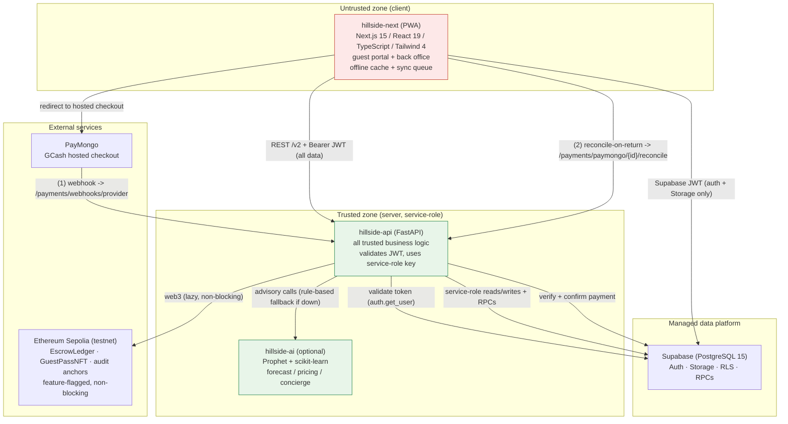

**Narrative.** The system is organized as independently deployed services across a clear **trust boundary**. The browser and the Progressive Web Application run in the **untrusted zone**: they are treated as if the user could tamper with them, so they hold no privileged credentials. The `@supabase/supabase-js` client is used only for authentication and file uploads; every piece of business data flows through the backend. The **trusted zone** contains the FastAPI backend, which validates each request's Supabase token and then performs all privileged work with a service-role credential, and the optional AI microservice, which the backend calls for advisory forecasting, pricing, and concierge suggestions and bypasses with rule-based defaults when it is unavailable. **Supabase** (PostgreSQL) is the managed data platform, providing authentication, file storage, row-level security, and the database functions that hold transactional business logic.

Two **external services** sit outside the trust boundary. **PayMongo** processes online GCash payments through a hosted checkout page, and confirmation reaches the backend by two independent paths — a server-to-server webhook and an active reconciliation triggered when the guest returns — so a delayed or missed webhook never leaves a payment unconfirmed. The **Ethereum Sepolia** test network hosts the optional blockchain audit layer (the EscrowLedger and GuestPassNFT contracts and the audit-log anchors); its calls are feature-flagged and non-blocking, so the reservation, payment, and check-in functions continue to operate whether or not the chain is reachable. This architecture keeps guest data private and server-side while adding an external, tamper-evident proof layer as an optional capability.

4.4.2 Data Modeling

4.4.2.1 Entity Relationship Diagram / Model

## Figure 4.2 — Entity Relationship Diagram (Relationship Overview)

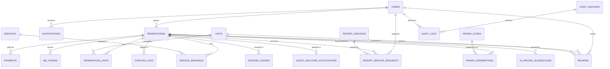

*The reservation is the central entity of the system: it will connect to the guest who places it, the units and tours booked, the payments and promotional redemptions applied to it, the in-stay service requests charged to it, the QR tokens and check-in logs used at arrival, the reviews written for it, and the escrow and audit records that support its verifiability. The `users` table is referenced by nearly every other table, either as the guest or as the staff member who performs an action.*

---

## Figure 4.3 — Core Booking Domain

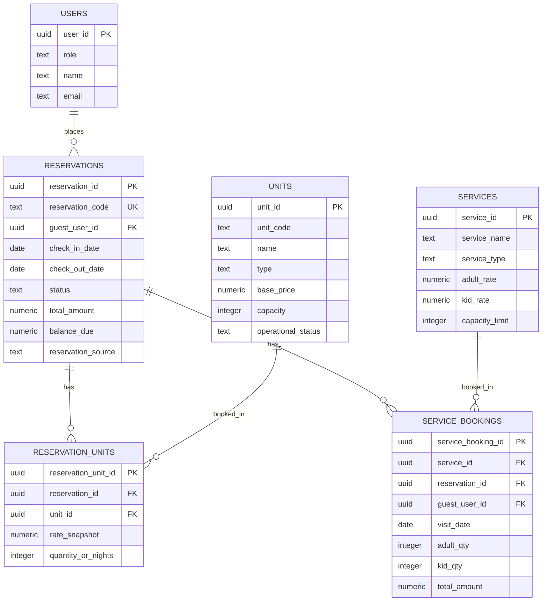

*A reservation represents either a stay or a tour (or both). A stay is expressed through one or more `reservation_units` rows, each snapshotting the rate and the number of nights or quantity for a booked unit; a tour is expressed through a `service_bookings` row that records the visit date and adult/child quantities against a service. Rates are snapshotted at booking time so later catalog price changes do not alter existing reservations.*

---

## Figure 4.4 — Payments and Promotions Domain

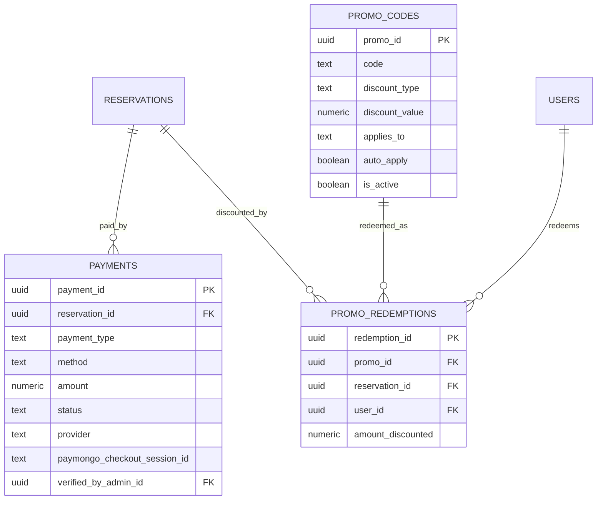

*Each payment is linked to a reservation and records the method (cash, GCash, bank, or card), the type (deposit, full, or on-site), the verification status, and — for online payments — the PayMongo checkout references. Promotional discounts are recorded as `promo_redemptions` that link a promo code, the reservation it was applied to, and the guest, together with the peso amount discounted.*

---

## Figure 4.5 — In-Stay Services and Folio Domain

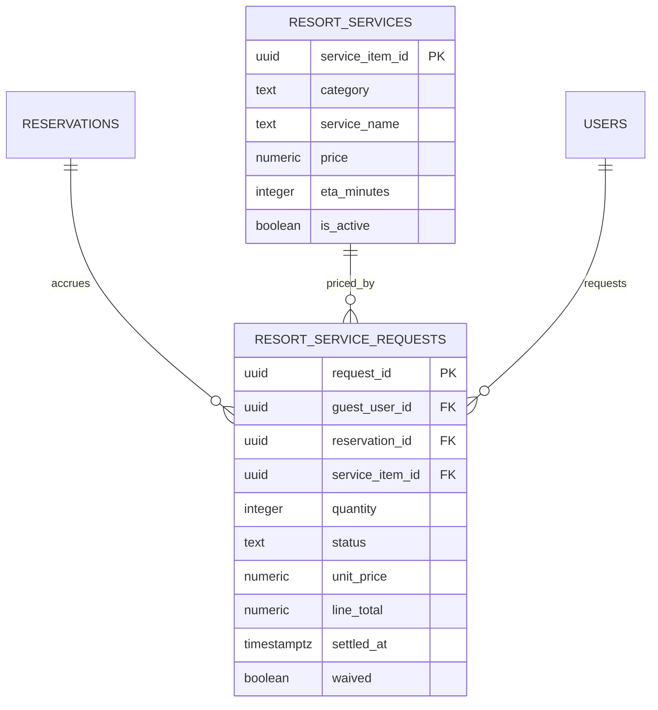

*During a stay, a guest requests in-stay services (for example room service or spa) from the `resort_services` catalog. Each request snapshots the unit price and computes a line total at creation. A request becomes a billable folio charge only once it is completed and is neither waived nor already settled; the folio is collected at check-out.*

---

## Figure 4.6 — Check-in, QR, and Reviews Domain

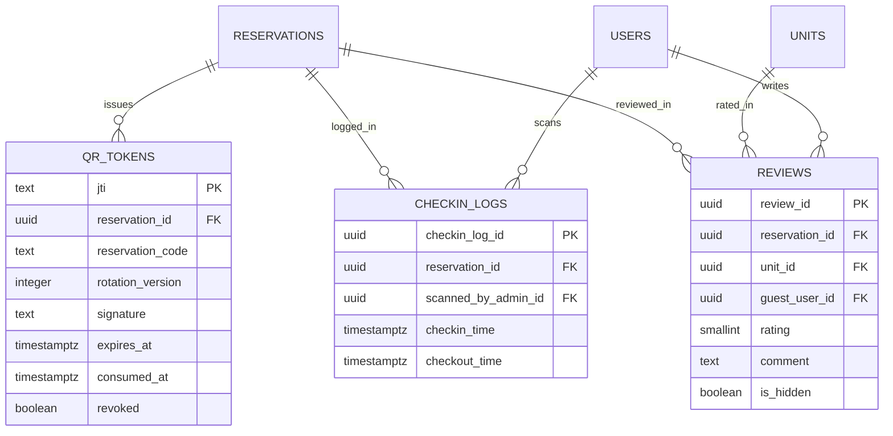

*Each confirmed reservation issues a signed, single-use QR token (Ed25519 signature, rotation version, expiry, and consumption tracking). A check-in log records who scanned the guest in and out. Reviews are tied to both a reservation and a unit, so only stays (which have a unit) can be reviewed; tours, which have no unit, cannot.*

---

## Figure 4.7 — Blockchain, Audit, and AI Domain

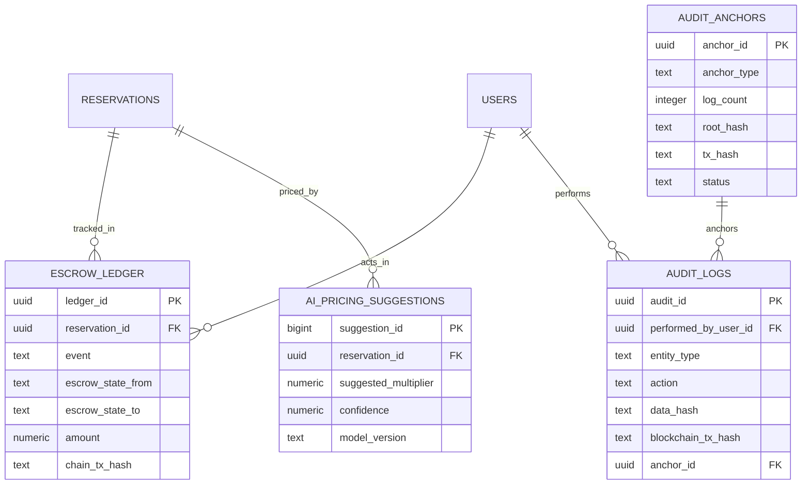

*The escrow ledger records each escrow state transition of a reservation. Every privileged action writes an audit log entry containing a SHA-256 hash of its contents; batches of audit entries are summarized by an anchor whose root hash can be recorded on the Ethereum Sepolia test network for tamper evidence. The AI pricing suggestions link advisory pricing output to a reservation. (The `ai_forecasts` and `ai_concierge_suggestions` tables are standalone advisory records and are shown in the data dictionary.)*

---

4.4.2.2 Database Schema / Structure

The database schema is documented in the data dictionary below, generated directly from the live PostgreSQL schema (25 tables). Each table lists its fields, data types, constraints (PK = primary key, FK = foreign key, UK = unique, NN = not null, and defaults), and a short description.

## ai_concierge_suggestions
*Advisory AI concierge suggestion runs by guest segment.*

| Field | Type | Constraints | Description |
| --- | --- | --- | --- |
| `suggestion_run_id` | bigint | PK | Unique concierge-run id. |
| `segment_key` | text | NN | Guest segment key. |
| `stay_type` | text | — | Stay type context (stay/tour). |
| `model_version` | text | NN | AI model version identifier. |
| `source` | text | NN default 'hillside-ai' | Producer of the record (e.g. hillside-ai). |
| `behavior` | jsonb | NN default '{}' | JSON anonymized behavior signals. |
| `suggestions` | jsonb | NN default '[]' | JSON list of AI suggestions. |
| `notes` | jsonb | NN default '[]' | JSON notes. |
| `created_by_user_id` | uuid | FK→users.user_id | User who generated the run. |
| `generated_at` | timestamptz | NN default now() | Generation timestamp. |
| `created_at` | timestamptz | NN default now() | Record creation timestamp. |

## ai_forecasts
*Advisory AI occupancy forecast runs (horizon, series, model version).*

| Field | Type | Constraints | Description |
| --- | --- | --- | --- |
| `forecast_id` | bigint | PK | Unique forecast id. |
| `forecast_type` | text | NN | Forecast type. |
| `start_date` | date | NN | Forecast start date. |
| `horizon_days` | integer | NN | Forecast horizon in days. |
| `model_version` | text | NN | AI model version identifier. |
| `source` | text | NN default 'hillside-ai' | Producer of the record (e.g. hillside-ai). |
| `inputs` | jsonb | NN default '{}' | JSON forecast inputs. |
| `series` | jsonb | NN default '[]' | JSON forecast series. |
| `created_by_user_id` | uuid | FK→users.user_id | User who generated the run. |
| `generated_at` | timestamptz | NN default now() | Generation timestamp. |
| `created_at` | timestamptz | NN default now() | Record creation timestamp. |

## ai_pricing_suggestions
*Advisory AI pricing outputs (multiplier, confidence, explanations) per reservation.*

| Field | Type | Constraints | Description |
| --- | --- | --- | --- |
| `suggestion_id` | bigint | PK | Unique pricing-suggestion id. |
| `reservation_id` | uuid | FK→reservations.reservation_id | Owning reservation identifier. |
| `segment_key` | text | — | Guest segment key. |
| `check_in_date` | date | — | Arrival date. |
| `check_out_date` | date | — | Departure date. |
| `visit_date` | date | — | Tour visit date. |
| `suggested_multiplier` | numeric | — | Suggested price multiplier. |
| `demand_bucket` | text | — | Demand classification bucket. |
| `pricing_adjustment` | numeric | NN | Suggested price adjustment. |
| `confidence` | numeric | NN | Model confidence (0-1). |
| `model_version` | text | NN | AI model version identifier. |
| `source` | text | NN default 'hillside-ai' | Producer of the record (e.g. hillside-ai). |
| `features` | jsonb | NN default '{}' | JSON model input features. |
| `explanations` | jsonb | NN default '[]' | JSON explanations. |
| `signal_breakdown` | jsonb | NN default '[]' | JSON signal breakdown. |
| `confidence_breakdown` | jsonb | NN default '{}' | JSON confidence breakdown. |
| `created_by_user_id` | uuid | FK→users.user_id | User who generated the run. |
| `generated_at` | timestamptz | NN default now() | Generation timestamp. |
| `created_at` | timestamptz | NN default now() | Record creation timestamp. |

## audit_anchors
*Batched Merkle/root-hash anchors of audit logs submitted (or pending) on-chain.*

| Field | Type | Constraints | Description |
| --- | --- | --- | --- |
| `anchor_id` | uuid | PK default gen_random_uuid() | Anchor batch this log belongs to. |
| `anchor_type` | text | NN | Anchor type. |
| `scope` | text | NN | Scope of the anchored batch. |
| `range_start` | timestamptz | NN | Start of the anchored time range. |
| `range_end` | timestamptz | NN | End of the anchored time range. |
| `log_count` | integer | NN | Number of logs in the batch. |
| `root_hash` | text | NN | Root hash summarizing the batch. |
| `tx_hash` | text | — | On-chain submission tx hash. |
| `chain_id` | text | NN | Numeric chain id. |
| `status` | text | NN | Lifecycle status of the record. |
| `error_message` | text | — | Error message if submission failed. |
| `created_at` | timestamptz | NN default now() | Record creation timestamp. |
| `submitted_at` | timestamptz | — | Submission time. |
| `confirmed_at` | timestamptz | — | On-chain confirmation time. |

## audit_logs
*Tamper-evident log of privileged actions, each with a content hash and optional anchor.*

| Field | Type | Constraints | Description |
| --- | --- | --- | --- |
| `audit_id` | uuid | PK default gen_random_uuid() | Unique audit-log id. |
| `performed_by_user_id` | uuid | FK→users.user_id | User who performed the action. |
| `entity_type` | text | NN | Related entity type. |
| `entity_id` | text | NN | Related entity id. |
| `action` | text | NN | Action performed. |
| `data_hash` | text | NN | SHA-256 hash of the record contents. |
| `blockchain_tx_hash` | text | — | On-chain tx hash if anchored. |
| `metadata` | jsonb | — | Additional JSON metadata. |
| `ip_address` | inet | — | Client IP address. |
| `user_agent` | text | — | Client user agent. |
| `timestamp` | timestamptz | NN default now() | Action timestamp. |
| `anchor_id` | uuid | FK→audit_anchors.anchor_id | Anchor batch this log belongs to. |

## checkin_logs
*Check-in and check-out event log per reservation, with the scanning staff member.*

| Field | Type | Constraints | Description |
| --- | --- | --- | --- |
| `checkin_log_id` | uuid | PK default gen_random_uuid() | Unique check-in log id. |
| `reservation_id` | uuid | FK→reservations.reservation_id NN | Owning reservation identifier. |
| `scanned_by_admin_id` | uuid | FK→users.user_id | Staff who scanned the guest. |
| `checkin_time` | timestamptz | — | Check-in timestamp. |
| `checkout_time` | timestamptz | — | Check-out timestamp. |
| `remarks` | text | — | Free-text remarks. |
| `updated_at` | timestamptz | NN default now() | Last update timestamp. |
| `sync_version` | bigint | NN default 1 | Optimistic-concurrency/sync version counter. |

## escrow_ledger
*Ledger of reservation escrow state transitions, with actor and optional chain tx.*

| Field | Type | Constraints | Description |
| --- | --- | --- | --- |
| `ledger_id` | uuid | PK default gen_random_uuid() | Unique escrow-ledger id. |
| `reservation_id` | uuid | FK→reservations.reservation_id NN | Owning reservation identifier. |
| `reservation_code` | text | — | Human-readable reservation code. |
| `event` | text | NN | Escrow event name. |
| `escrow_state_from` | text | — | Previous escrow state. |
| `escrow_state_to` | text | — | New escrow state. |
| `policy_outcome` | text | — | Policy outcome (e.g. forfeited, refunded, released). |
| `amount` | numeric | — | Payment amount. |
| `reason` | text | — | Reason for the transition. |
| `actor_role` | text | — | Role of the actor. |
| `actor_user_id` | uuid | FK→users.user_id | User who performed the action. |
| `chain_tx_hash` | text | — | On-chain transaction hash. |
| `metadata` | jsonb | NN default '{}' | Additional JSON metadata. |
| `created_at` | timestamptz | NN default now() | Record creation timestamp. |

## guest_welcome_notifications
*AI concierge check-in welcome records surfaced on the staff check-in screen.*

| Field | Type | Constraints | Description |
| --- | --- | --- | --- |
| `notification_id` | uuid | PK default gen_random_uuid() | Unique notification id. |
| `reservation_id` | uuid | FK→reservations.reservation_id NN | Owning reservation identifier. |
| `guest_user_id` | uuid | FK→users.user_id NN | Guest who owns the record. |
| `event_type` | text | NN default 'checkin_welcome' | Machine event type. |
| `title` | text | NN | Notification title. |
| `message` | text | NN | Message body. |
| `suggestions` | jsonb | NN default '[]' | JSON list of AI suggestions. |
| `model_version` | text | — | AI model version identifier. |
| `source` | text | NN default 'hillside-ai' | Producer of the record (e.g. hillside-ai). |
| `fallback_used` | boolean | NN default false | Whether a rule-based fallback produced the result. |
| `metadata` | jsonb | NN default '{}' | Additional JSON metadata. |
| `created_at` | timestamptz | NN default now() | Record creation timestamp. |
| `read_at` | timestamptz | — | Time the notification was read. |

## notifications
*General in-app notifications for guests and back-office users (the bell).*

| Field | Type | Constraints | Description |
| --- | --- | --- | --- |
| `notification_id` | uuid | PK default gen_random_uuid() | Unique notification id. |
| `recipient_user_id` | uuid | FK→users.user_id NN | User the notification is for. |
| `category` | text | NN | Service category (e.g. room_service, spa). |
| `event_type` | text | NN | Machine event type. |
| `title` | text | NN | Notification title. |
| `body` | text | — | Notification body text. |
| `severity` | text | NN default 'info' | Severity (info/success/warning/critical). |
| `entity_type` | text | — | Related entity type. |
| `entity_id` | text | — | Related entity id. |
| `link` | text | — | Deep link target. |
| `metadata` | jsonb | NN default '{}' | Additional JSON metadata. |
| `dedupe_key` | text | — | Key used to prevent duplicate notifications. |
| `created_at` | timestamptz | NN default now() | Record creation timestamp. |
| `read_at` | timestamptz | — | Time the notification was read. |

## payments
*Payments against a reservation (online/manual/on-site) with status and PayMongo references.*

| Field | Type | Constraints | Description |
| --- | --- | --- | --- |
| `payment_id` | uuid | PK default gen_random_uuid() | Unique payment id. |
| `reservation_id` | uuid | FK→reservations.reservation_id NN | Owning reservation identifier. |
| `payment_type` | text | NN | Payment type: deposit, full, or on_site. |
| `method` | text | NN | Method: cash, gcash, bank, or card. |
| `amount` | numeric | NN | Payment amount. |
| `reference_no` | text | — | Payment reference number. |
| `proof_url` | text | — | Uploaded proof-of-payment URL. |
| `status` | text | NN default 'pending' | Lifecycle status of the record. |
| `verified_by_admin_id` | uuid | FK→users.user_id | Staff who verified the payment. |
| `verified_at` | timestamptz | — | Verification timestamp. |
| `created_at` | timestamptz | default now() | Record creation timestamp. |
| `rejected_reason` | text | — | Reason a payment was rejected. |
| `rejected_at` | timestamptz | — | Rejection timestamp. |
| `rejected_by_admin_id` | uuid | FK→users.user_id | Staff who rejected the payment. |
| `updated_at` | timestamptz | NN default now() | Last update timestamp. |
| `sync_version` | bigint | NN default 1 | Optimistic-concurrency/sync version counter. |
| `provider` | text | — | Payment provider (e.g. paymongo). |
| `paymongo_checkout_session_id` | text | — | PayMongo checkout session id. |
| `paymongo_payment_intent_id` | text | — | PayMongo payment intent id. |
| `paymongo_payment_id` | text | — | PayMongo payment id. |
| `paymongo_checkout_url` | text | — | PayMongo hosted checkout URL. |

## promo_codes
*Discount code definitions (percentage/fixed, limits, auto-apply, active window).*

| Field | Type | Constraints | Description |
| --- | --- | --- | --- |
| `promo_id` | uuid | PK default gen_random_uuid() | Unique promo id. |
| `code` | text | — | Promo code string. |
| `description` | text | — | Free-text description. |
| `discount_type` | text | NN | Discount type (percentage or fixed). |
| `discount_value` | numeric | NN | Discount value. |
| `max_discount` | numeric | — | Maximum discount cap. |
| `min_total` | numeric | NN default 0 | Minimum total to qualify. |
| `starts_at` | timestamptz | — | Validity start. |
| `ends_at` | timestamptz | — | Validity end. |
| `usage_limit` | integer | — | Global usage limit. |
| `used_count` | integer | NN default 0 | Times used. |
| `per_user_limit` | integer | — | Per-user usage limit. |
| `applies_to` | text | NN default 'stays' | Scope: stays or tours. |
| `is_active` | boolean | NN default true | Whether the record is active/visible. |
| `created_by` | uuid | FK→users.user_id | User who created the promo. |
| `created_at` | timestamptz | NN default now() | Record creation timestamp. |
| `updated_at` | timestamptz | NN default now() | Last update timestamp. |
| `auto_apply` | boolean | NN default false | Whether the promo auto-applies. |

## promo_redemptions
*Records of a promo applied to a reservation, with amount discounted.*

| Field | Type | Constraints | Description |
| --- | --- | --- | --- |
| `redemption_id` | uuid | PK default gen_random_uuid() | Unique redemption id. |
| `promo_id` | uuid | FK→promo_codes.promo_id NN | Unique promo id. |
| `reservation_id` | uuid | FK→reservations.reservation_id | Owning reservation identifier. |
| `user_id` | uuid | FK→users.user_id | Unique user identifier (matches Supabase auth user). |
| `amount_discounted` | numeric | NN default 0 | Peso amount discounted. |
| `created_at` | timestamptz | NN default now() | Record creation timestamp. |

## qr_tokens
*Signed, single-use, rotating QR check-in tokens for reservations.*

| Field | Type | Constraints | Description |
| --- | --- | --- | --- |
| `jti` | text | PK | JWT token id (primary key of the QR token). |
| `reservation_id` | uuid | FK→reservations.reservation_id NN | Owning reservation identifier. |
| `reservation_code` | text | NN | Human-readable reservation code. |
| `rotation_version` | integer | NN | Signing-key rotation version. |
| `signature` | text | NN | Ed25519 signature of the token payload. |
| `token_payload` | text | NN | Signed token payload. |
| `issued_at` | timestamptz | NN default timezone('utc' | Token issue time. |
| `expires_at` | timestamptz | NN | Token expiry time. |
| `consumed_at` | timestamptz | — | Time the token was consumed. |
| `consumed_by_scanner_id` | text | — | Scanner that consumed the token. |
| `revoked` | boolean | NN default false | Whether the token is revoked. |
| `metadata` | jsonb | NN default '{}' | Additional JSON metadata. |
| `created_at` | timestamptz | NN default timezone('utc' | Record creation timestamp. |

## reservation_units
*Line items linking a reservation to booked units with snapshotted rate and quantity/nights.*

| Field | Type | Constraints | Description |
| --- | --- | --- | --- |
| `reservation_unit_id` | uuid | PK default gen_random_uuid() | Unique line-item id. |
| `reservation_id` | uuid | FK→reservations.reservation_id NN | Owning reservation identifier. |
| `unit_id` | uuid | FK→units.unit_id NN | Unique unit identifier. |
| `rate_snapshot` | numeric | NN | Rate captured at booking time. |
| `quantity_or_nights` | integer | NN default 1 | Quantity of units or number of nights. |

## reservations
*Central booking entity: dates, money, status, escrow/chain proofs, and policy fields.*

| Field | Type | Constraints | Description |
| --- | --- | --- | --- |
| `reservation_id` | uuid | PK default gen_random_uuid() | Owning reservation identifier. |
| `reservation_code` | text | UK NN | Human-readable reservation code. |
| `guest_user_id` | uuid | FK→users.user_id NN | Guest who owns the record. |
| `check_in_date` | date | NN | Arrival date. |
| `check_out_date` | date | NN | Departure date. |
| `status` | text | NN default 'pending_payment' | Lifecycle status of the record. |
| `total_amount` | numeric | NN default 0 | Total booking amount. |
| `deposit_required` | numeric | default 0 | Required deposit amount. |
| `amount_paid_verified` | numeric | default 0 | Sum of verified payments. |
| `balance_due` | numeric | — | Remaining balance owed. |
| `hold_expires_at` | timestamptz | — | Expiry time of an unpaid hold. |
| `notes` | text | — | JSON notes. |
| `created_at` | timestamptz | default now() | Record creation timestamp. |
| `updated_at` | timestamptz | default now() | Last update timestamp. |
| `expected_pay_now` | numeric | — | Amount expected to be paid now (deposit or full). |
| `escrow_state` | text | NN default 'none' | Escrow shadow state (none/pending_lock/locked/released/refunded/failed). |
| `chain_key` | text | — | Blockchain network key. |
| `chain_id` | integer | — | Numeric chain id. |
| `escrow_contract_address` | text | — | Escrow contract address. |
| `chain_tx_hash` | text | — | On-chain transaction hash. |
| `onchain_booking_id` | text | — | On-chain booking identifier. |
| `escrow_event_index` | integer | — | On-chain event index. |
| `guest_pass_token_id` | bigint | — | Guest-pass token id. |
| `guest_pass_tx_hash` | text | — | Guest-pass mint tx hash. |
| `guest_pass_chain_key` | text | — | Guest-pass chain key. |
| `guest_pass_reservation_hash` | text | — | Hash binding the pass to the reservation. |
| `guest_pass_minted_at` | timestamptz | — | Guest-pass mint timestamp. |
| `guest_count` | integer | NN default 1 | Number of guests. |
| `escrow_release_attempts` | integer | NN default 0 | Count of escrow release attempts. |
| `escrow_release_last_attempt_at` | timestamptz | — | Last escrow release attempt time. |
| `escrow_release_last_error` | text | — | Last escrow release error message. |
| `reservation_source` | text | NN default 'online' | Origin: online or walk-in. |
| `sync_version` | bigint | NN default 1 | Optimistic-concurrency/sync version counter. |
| `deposit_policy_version` | text | — | Deposit policy version applied. |
| `deposit_rule_applied` | text | — | Deposit rule identifier applied. |
| `cancellation_actor` | text | — | Who cancelled (guest/staff/system). |
| `policy_outcome` | text | — | Policy outcome (e.g. forfeited, refunded, released). |
| `original_total` | numeric | — | Total before discount. |
| `discount_amount` | numeric | NN default 0 | Total discount applied. |
| `promo_code` | text | — | Applied promo code text. |

## resort_service_requests
*In-stay service requests / folio charges with price snapshot, status, and settlement.*

| Field | Type | Constraints | Description |
| --- | --- | --- | --- |
| `request_id` | uuid | PK default gen_random_uuid() | Unique service-request id. |
| `guest_user_id` | uuid | FK→users.user_id NN | Guest who owns the record. |
| `reservation_id` | uuid | FK→reservations.reservation_id | Owning reservation identifier. |
| `service_item_id` | uuid | FK→resort_services.service_item_id NN | Unique in-stay service item identifier. |
| `quantity` | integer | NN default 1 | Requested quantity. |
| `preferred_time` | timestamptz | — | Preferred fulfillment time. |
| `notes` | text | — | JSON notes. |
| `status` | text | NN default 'new' | Lifecycle status of the record. |
| `requested_at` | timestamptz | NN default now() | Time the request was raised. |
| `processed_at` | timestamptz | — | Time the request was processed. |
| `processed_by_user_id` | uuid | FK→users.user_id | Staff who processed the request. |
| `updated_at` | timestamptz | NN default now() | Last update timestamp. |
| `sync_version` | bigint | NN default 1 | Optimistic-concurrency/sync version counter. |
| `unit_price` | numeric | NN default 0 | Snapshotted unit price. |
| `line_total` | numeric | NN default 0 | Snapshotted line total. |
| `settled_at` | timestamptz | — | Time the charge was settled. |
| `settlement_payment_id` | uuid | — | Payment that settled the charge. |
| `waived` | boolean | NN default false | Whether the charge was waived. |
| `waived_by_user_id` | uuid | — | Staff who waived the charge. |
| `waived_at` | timestamptz | — | Time the charge was waived. |
| `settled_method` | text | — | Tender used to settle. |

## resort_services
*Catalog of in-stay add-on services (e.g. room service, spa) with price and ETA.*

| Field | Type | Constraints | Description |
| --- | --- | --- | --- |
| `service_item_id` | uuid | PK default gen_random_uuid() | Unique in-stay service item identifier. |
| `category` | text | NN | Service category (e.g. room_service, spa). |
| `service_name` | text | NN | Service/tour name. |
| `description` | text | — | Free-text description. |
| `price` | numeric | NN default 0 | Unit price. |
| `eta_minutes` | integer | — | Estimated fulfillment time in minutes. |
| `is_active` | boolean | NN default true | Whether the record is active/visible. |
| `created_at` | timestamptz | NN default now() | Record creation timestamp. |
| `updated_at` | timestamptz | NN default now() | Last update timestamp. |

## reviews
*Guest star ratings and comments for completed stays (unit-linked), with moderation flag.*

| Field | Type | Constraints | Description |
| --- | --- | --- | --- |
| `review_id` | uuid | PK default gen_random_uuid() | Unique review id. |
| `reservation_id` | uuid | FK→reservations.reservation_id NN | Owning reservation identifier. |
| `unit_id` | uuid | FK→units.unit_id NN | Unique unit identifier. |
| `guest_user_id` | uuid | FK→users.user_id NN | Guest who owns the record. |
| `rating` | smallint | NN | Star rating (1-5). |
| `comment` | text | — | Review comment. |
| `is_hidden` | boolean | NN default false | Whether the review is hidden by moderation. |
| `created_at` | timestamptz | NN default now() | Record creation timestamp. |
| `updated_at` | timestamptz | NN default now() | Last update timestamp. |

## service_bookings
*Tour line item linking a reservation to a service with visit date and party sizes.*

| Field | Type | Constraints | Description |
| --- | --- | --- | --- |
| `service_booking_id` | uuid | PK default gen_random_uuid() | Unique tour line id. |
| `service_id` | uuid | FK→services.service_id NN | Unique tour service identifier. |
| `reservation_id` | uuid | FK→reservations.reservation_id NN | Owning reservation identifier. |
| `guest_user_id` | uuid | FK→users.user_id NN | Guest who owns the record. |
| `visit_date` | date | NN | Tour visit date. |
| `adult_qty` | integer | NN default 0 | Number of adults. |
| `kid_qty` | integer | NN default 0 | Number of children. |
| `adult_rate_snapshot` | numeric | NN default 0 | Adult rate captured at booking. |
| `kid_rate_snapshot` | numeric | NN default 0 | Child rate captured at booking. |
| `total_amount` | numeric | NN default 0 | Total booking amount. |
| `status` | text | NN default 'pending_payment' | Lifecycle status of the record. |
| `created_at` | timestamptz | default now() | Record creation timestamp. |

## services
*Tour offerings (day/night tours) with schedule, adult/child rates, and capacity.*

| Field | Type | Constraints | Description |
| --- | --- | --- | --- |
| `service_id` | uuid | PK default gen_random_uuid() | Unique tour service identifier. |
| `service_name` | text | UK NN | Service/tour name. |
| `service_type` | text | UK NN | Service type/category. |
| `start_time` | time | NN | Service start time. |
| `end_time` | time | NN | Service end time. |
| `adult_rate` | numeric | NN default 0 | Per-adult rate. |
| `kid_rate` | numeric | NN default 0 | Per-child rate. |
| `kid_age_rule` | text | — | Rule defining child age eligibility. |
| `status` | text | NN default 'active' | Lifecycle status of the record. |
| `capacity_limit` | integer | — | Maximum capacity for the service. |
| `description` | text | — | Free-text description. |
| `created_at` | timestamptz | default now() | Record creation timestamp. |
| `updated_at` | timestamptz | default now() | Last update timestamp. |
| `image_urls` | text[] | NN default '{}' | List of image URLs. |
| `image_thumb_urls` | text[] | NN default '{}' | List of thumbnail URLs. |

## sync_change_events
*Server-emitted change feed consumed by offline clients (entity, action, version).*

| Field | Type | Constraints | Description |
| --- | --- | --- | --- |
| `event_id` | bigint | PK default nextval('sync_change_eve… | Unique change-event id. |
| `entity_type` | text | NN | Related entity type. |
| `entity_id` | text | NN | Related entity id. |
| `action` | text | NN | Action performed. |
| `version` | bigint | NN default 0 | Change version number. |
| `changed_at` | timestamptz | NN default now() | Change timestamp. |
| `payload` | jsonb | NN default '{}' | JSON change payload. |

## sync_operation_receipts
*Idempotency and conflict receipts for offline push operations.*

| Field | Type | Constraints | Description |
| --- | --- | --- | --- |
| `operation_id` | text | PK | Idempotency operation id (primary key). |
| `idempotency_key` | text | NN | Client idempotency key. |
| `user_id` | uuid | FK→users.user_id NN | Unique user identifier (matches Supabase auth user). |
| `entity_type` | text | NN | Related entity type. |
| `entity_id` | text | — | Related entity id. |
| `action` | text | NN | Action performed. |
| `status` | text | NN | Lifecycle status of the record. |
| `http_status` | integer | NN default 200 | Stored HTTP status. |
| `conflict` | boolean | NN default false | Whether a conflict occurred. |
| `server_version` | bigint | — | Server version at processing. |
| `resolution_hint` | text | — | Conflict-resolution hint. |
| `error_code` | text | — | Error code. |
| `error_message` | text | — | Error message if submission failed. |
| `response_payload` | jsonb | NN default '{}' | Stored response payload. |
| `metadata` | jsonb | NN default '{}' | Additional JSON metadata. |
| `created_at` | timestamptz | NN default now() | Record creation timestamp. |
| `updated_at` | timestamptz | NN default now() | Last update timestamp. |

## sync_upload_items
*Deferred media uploads queued by offline clients, with storage and checksum info.*

| Field | Type | Constraints | Description |
| --- | --- | --- | --- |
| `upload_id` | uuid | PK default gen_random_uuid() | Unique upload id. |
| `operation_id` | text | NN | Idempotency operation id (primary key). |
| `user_id` | uuid | FK→users.user_id NN | Unique user identifier (matches Supabase auth user). |
| `entity_type` | text | NN | Related entity type. |
| `entity_id` | text | NN | Related entity id. |
| `field_name` | text | NN | Target field for the upload. |
| `storage_bucket` | text | NN | Storage bucket name. |
| `storage_path` | text | NN | Storage object path. |
| `mime_type` | text | — | MIME type. |
| `size_bytes` | bigint | — | File size in bytes. |
| `checksum_sha256` | text | — | SHA-256 checksum. |
| `status` | text | NN default 'queued' | Lifecycle status of the record. |
| `failure_reason` | text | — | Failure reason if the upload failed. |
| `metadata` | jsonb | NN default '{}' | Additional JSON metadata. |
| `created_at` | timestamptz | NN default now() | Record creation timestamp. |
| `updated_at` | timestamptz | NN default now() | Last update timestamp. |

## units
*Bookable rooms and cottages with pricing, capacity, media, and housekeeping status.*

| Field | Type | Constraints | Description |
| --- | --- | --- | --- |
| `unit_id` | uuid | PK default gen_random_uuid() | Unique unit identifier. |
| `name` | text | UK NN | Display name. |
| `type` | text | UK NN | Unit type/category. |
| `description` | text | — | Free-text description. |
| `base_price` | numeric | NN default 0 | Nightly base price. |
| `capacity` | integer | NN default 2 | Maximum guests. |
| `is_active` | boolean | NN default true | Whether the record is active/visible. |
| `image_url` | text | — | Primary image URL. |
| `amenities` | text[] | default '{}' | List of amenity labels. |
| `created_at` | timestamptz | default now() | Record creation timestamp. |
| `updated_at` | timestamptz | default now() | Last update timestamp. |
| `image_urls` | text[] | default '{}' | List of image URLs. |
| `operational_status` | text | NN default 'cleaned' | Housekeeping/operational state (e.g. cleaned, occupied, dirty). |
| `unit_code` | text | NN | Human-readable unit code. |
| `room_number` | text | — | Physical room number. |
| `image_thumb_urls` | text[] | NN default '{}' | List of thumbnail URLs. |

## users
*System user accounts (mapped to Supabase auth) with role, contact, and optional wallet.*

| Field | Type | Constraints | Description |
| --- | --- | --- | --- |
| `user_id` | uuid | PK FK→None.None | Unique user identifier (matches Supabase auth user). |
| `role` | text | NN default 'guest' | Access role: guest, staff, admin, or super_admin. |
| `name` | text | NN | Display name. |
| `phone` | text | — | Contact phone number. |
| `email` | text | — | Email address. |
| `created_at` | timestamptz | default now() | Record creation timestamp. |
| `wallet_address` | text | — | Optional blockchain wallet address. |
| `wallet_chain` | text | NN default 'evm' | Wallet chain family (default evm). |

4.4.3 Process Modeling

4.4.3.1 Flowchart

## Figure 4.13 — Reservation Lifecycle Flowchart

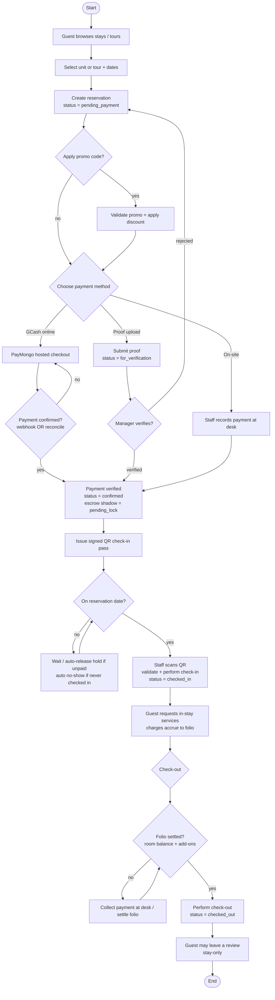

**Narrative.** The flowchart traces a reservation from creation to completion. A guest browses the catalog, selects a unit or tour with dates, and creates a reservation, which begins in the `pending_payment` state. An optional promo code is validated and applied before payment. The guest then pays by one of three routes: online through PayMongo GCash (confirmed by either the webhook or the reconciliation-on-return path), by uploading proof of payment for a manager to verify, or on-site at the desk. Once a payment is verified, the reservation becomes `confirmed` and its escrow shadow state is set. The system issues a signed, single-use QR pass. On the reservation date, staff scan the QR to check the guest in; if a hold goes unpaid or a confirmed guest never arrives, the automated jobs release the hold or mark a no-show. During the stay, in-stay service requests accrue to the folio. At check-out the folio (room balance plus add-on charges) must be settled before the reservation becomes `checked_out`, after which the guest may leave a review for a stay. This diagram describes the implemented flow; the manuscript refers to it in the future tense where it describes what the study will build.

4.4.3.2 Data Flow Diagram

## Figure 4.8 — Context Diagram (DFD Level 0)

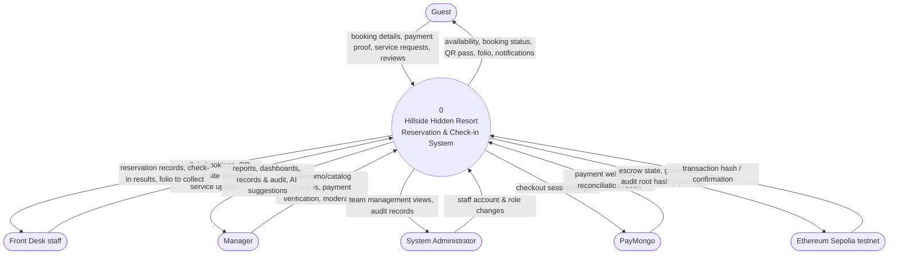

**Narrative.** At the context level the system is a single process that exchanges data with four categories of external actor and two external services. **Guests** send booking details, payment proofs, service requests, and reviews, and receive availability, booking status, their QR check-in pass, their folio, and notifications. **Front Desk staff** send walk-in bookings, QR scans, on-site payments, and service-queue updates, and receive reservation records, check-in results, and the folio to collect at check-out. **Managers** send catalog, promotion, and moderation changes and payment verifications, and receive reports, dashboards, the records-and-audit views, and advisory AI suggestions. The **System Administrator** sends staff-account and role changes and receives team-management and audit views.

Two external services complete the picture. The system sends a checkout-session request to **PayMongo** and receives payment confirmation through the webhook and the reconciliation result. When the optional blockchain layer is enabled, the system sends privacy-safe proofs — escrow state, the guest-pass, and an audit root hash — to the **Ethereum Sepolia** test network and receives a transaction hash confirming the record; guest personal data is never part of this flow.

4.4.3.3 Use Case Diagram

## Figure 4.9 — Guest Use Cases

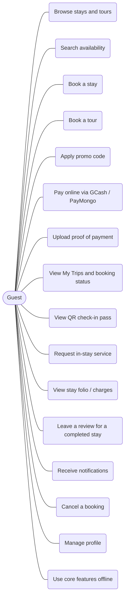

*The guest performs the full self-service lifecycle: discovering rooms and tours, booking and paying, tracking the reservation, presenting a QR pass at check-in, requesting in-stay services that accrue to the folio, and — after the stay — leaving a review. These use cases are all implemented in the guest portal and require the guest to be authenticated except for public browsing.*

## Figure 4.10 — Front Desk (staff) Use Cases

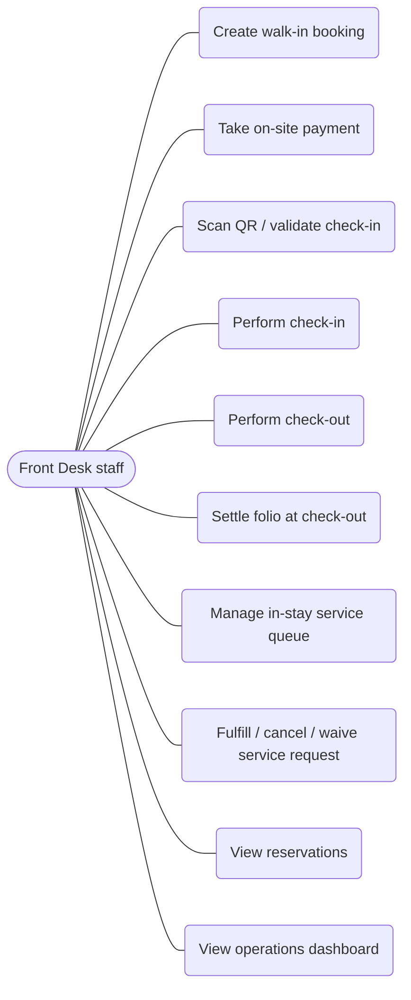

*Front Desk staff handle front-line operations at the resort: booking walk-in guests and taking payment at the counter, scanning the guest's QR to check them in and out, settling the folio at departure, and working the in-stay service queue.*

## Figure 4.11 — Manager (admin) Use Cases

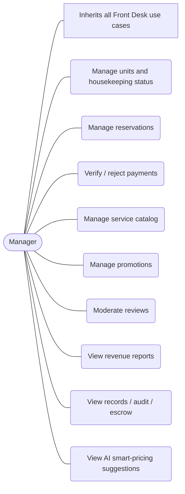

*The manager inherits every Front Desk use case and adds management functions: catalog and inventory (units, services, promotions), payment verification, review moderation, revenue reporting, and the records/audit/escrow console. The manager also reviews the advisory AI pricing suggestions.*

## Figure 4.12 — System Administrator (super_admin) Use Cases

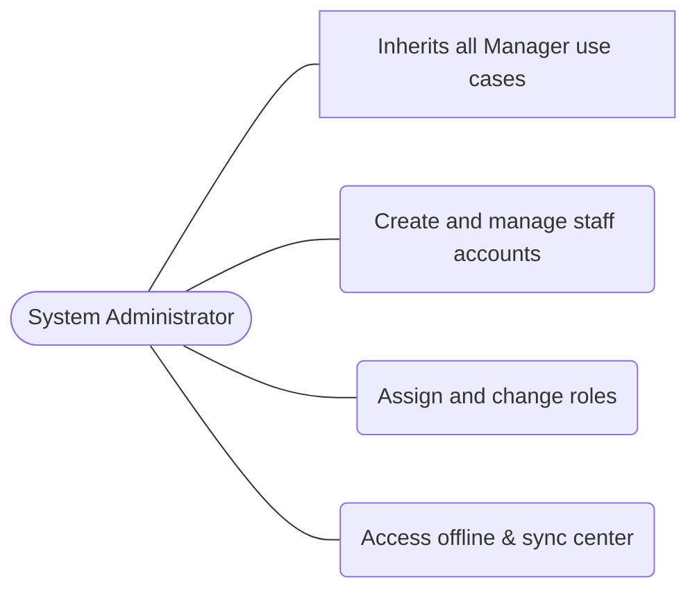

*The system administrator inherits every manager use case and adds the highest-privilege functions — creating and managing staff accounts and their roles (the Team module) — which no lower tier can perform.*

## Inheritance summary
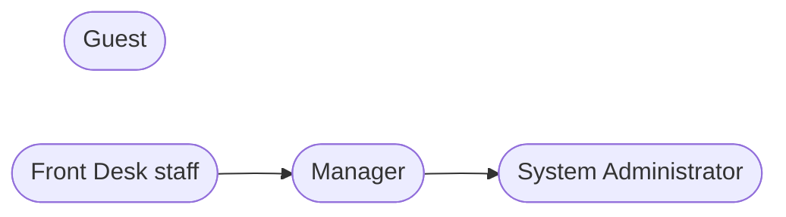
*Guest is an independent actor. Within the back office, each tier is a superset of the one before it: a manager can do everything a Front Desk staff member can, and a system administrator can do everything a manager can, plus staff-account management. This mirrors the system's role ranking (guest < staff < admin < super_admin), which is enforced both at the application-programming interface and in the database.*

4.5 User Interface Design

CHAPTER 5
TESTING AND EVALUATION
5.1 Test Plan
5.2 Unit / Integration Testing
5.3 System Acceptance Testing (SAT)
5.4 System Quality Metrics Evaluation Results

CHAPTER 6
CONCLUSIONS AND RECOMMENDATIONS
6.1 Summary of Findings
6.2 Conclusion
6.3 Recommendations

REFERENCES
Books
Journals/Articles/Issuances /Periodicals
Biørn-Hansen, A., Majchrzak, T. A., & Grønli, T. M. (2019). Progressive web apps: The possible web-native unifier for mobile development. Proceedings of the 14th International Conference on Web Information Systems and Technologies (WEBIST 2019), 344–351. https://doi.org/10.5220/0007728403440351
Bingöl, Z., & Yang, X. (2025). Smart tourism technologies and customer experience. Tourism Management Perspectives, 58, 101380. https://doi.org/10.1016/j.tmp.2025.101380
Buhalis, D., & Law, R. (2008). Progress in information technology and tourism management: 20 years on and 10 years after the Internet—The state of eTourism research. Tourism Management, 29(4), 609–623. https://doi.org/10.1016/j.tourman.2008.01.005
Casino, F., Dasaklis, T. K., & Patsakis, C. (2019). A systematic literature review of blockchain-based applications: Current status, classification and open issues. Telematics and Informatics, 36, 55–81. https://doi.org/10.1016/j.tele.2018.11.006

Department of Tourism. (2022). Tourism digital transformation strategy. Republic of the Philippines. https://beta.tourism.gov.ph
[Normal (Web)] Esguerra, J. G., & Arreza, M. K. B. (2021). The motivational factors on using virtual hotel operators' accommodation among tourists in Cebu City, Philippines. Journal of Business on Hospitality and Tourism, 7(3).
[Normal (Web)] Hao, F., & Chon, K. K. S. (2022). Contactless service in hospitality: Bridging customer equity, experience, delight, satisfaction, and trust. International Journal of Contemporary Hospitality Management, 34(1), 113–134.
Ivanov, S., & Webster, C. (2017). Adoption of robots, artificial intelligence, and service automation by travel, tourism and hospitality companies. Tourism Management Perspectives, 24, 74–87. https://doi.org/10.1016/j.tmp.2017.07.004
[Normal (Web)] Jiang, H. (2022). Research on hotel management based on internet of things and big data analysis. International Journal of Reliability, Quality and Safety Engineering, 29(5), 2240004.
Nakamoto, S. (2008). Bitcoin: A peer-to-peer electronic cash system. https://bitcoin.org/bitcoin.pdf

[Normal (Web)] Ramiscal, R. M. P., Martinez, M. J., Pallaya, J., Villasana, R., Alejandro, A. S., & Malinao, C. W. M. (2026). Smart hospitality: Key drivers of digital technology usage of hotels in Cauayan City, Isabela, Philippines. International Journal of Education Management and Religion, 3(2), 690–705. https://doi.org/10.71305/ijemr.v3i2.1373
[Normal (Web)] Ramento, L. F., Dancel, D. M., Taberlo, E., & Anquillano, K. J. (2024). Web-based reservation and management system for Nature Spring Resort. Journal of Pure and Applied Sciences, 2(2). https://doi.org/10.5281/zenodo.20739138
Electronic Sources
[Normal (Web)] Hilton. (2023). Hilton Honors booking platform. https://www.hilton.com
[Normal (Web)] Marriott International. (2023). Marriott Bonvoy hotel reservations. https://www.marriott.com

